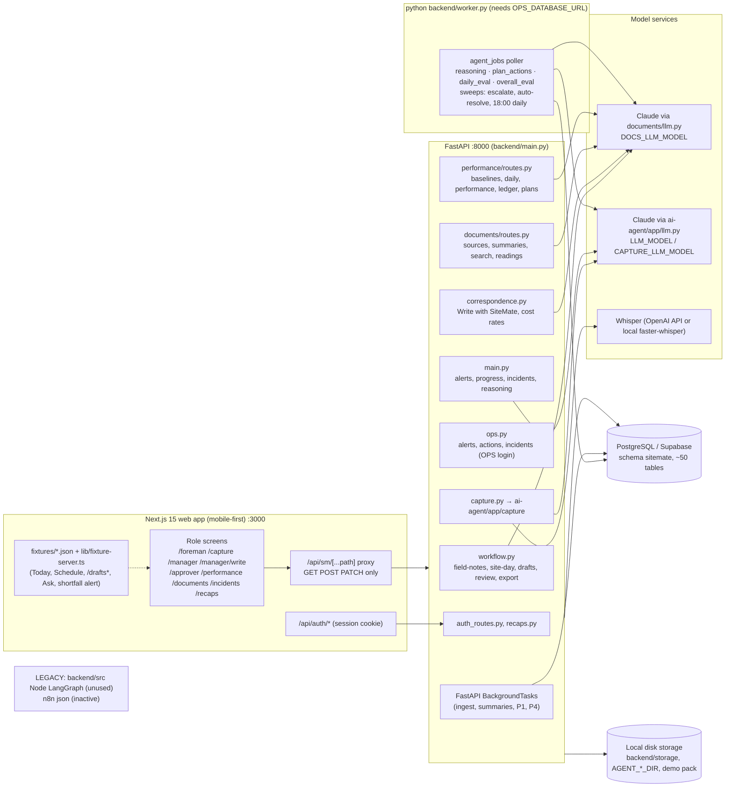
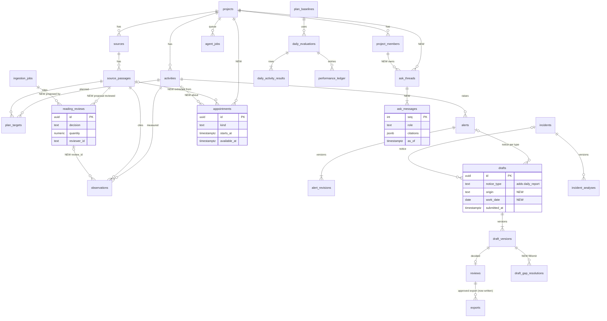
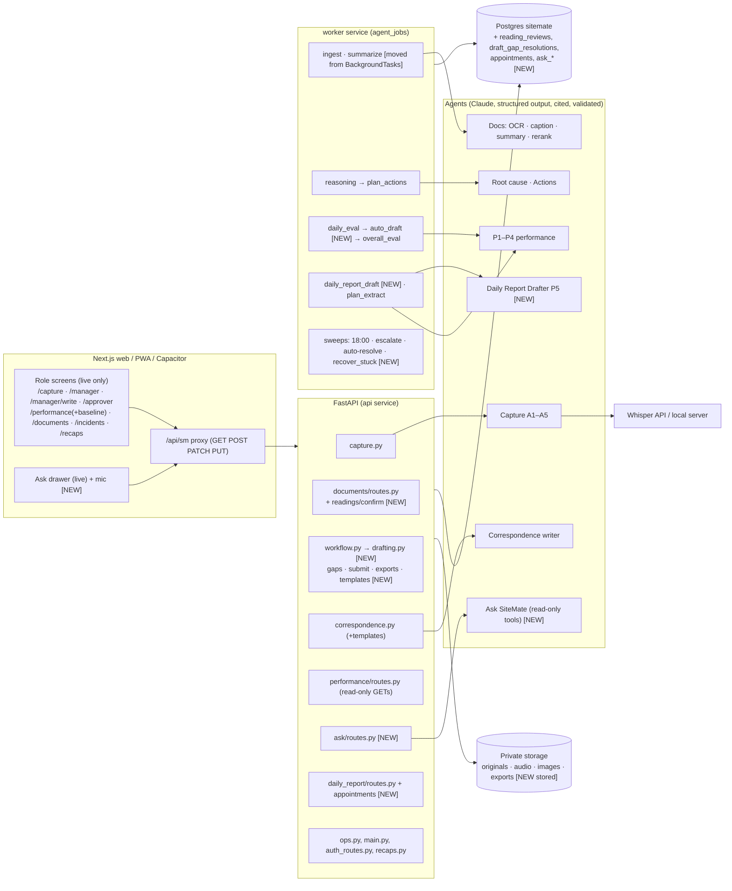
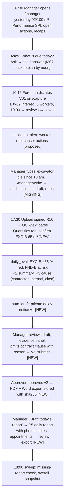
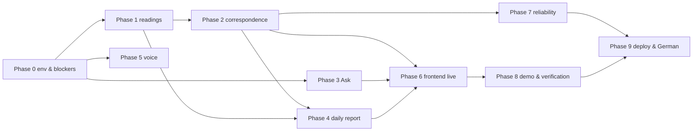

# SiteMate: Project Status, Gap Analysis and Implementation Plan

**Repository:** `construction-assistant/` (git root) · **Branch:** `blat` (clean, 48 commits, HEAD `5b03d7a "performance enhancement"`)
**Audit date:** 21 Nov 2026 · **Scope:** analysis only. This report changes no code, schema, migration, configuration or plan.
**Audience:** the engineers and the follow-up coding session that will finish SiteMate. Section 18 is the implementation spec. Sections 7–15 give the evidence and the detailed requirements behind it.

**Source priority:**
1. `Problem_Statement.txt`
2. the repository code
3. `plan/`
4. the READMEs

Where they conflict, section 6.5 records the conflict and how to resolve it.

**Evidence conventions**
- `path:line` refers to a file in this repository.
- **UNVERIFIED** marks a claim taken from reading code that was not executed during the audit.
- These checks were executed:
  - `pytest tests ../ai-agent/tests` from `backend/` with no test database: **90 passed, 34 skipped**. The skipped tests need `TEST_DATABASE_URL`.
  - `npx tsc --noEmit --incremental false` in `frontend/`: **exit 0**.
  - Alembic revision chain: inspected statically.
  - `.env` key names: inspected, never values.
- These were **not** executed: migrations against a database, the API, the worker, the `verify_*.py` scripts, `npm run build`, and any LLM call.

---

## 1. Executive Summary

SiteMate is much further along than a typical hackathon prototype. It runs as one FastAPI service (`backend/main.py`, 9 routers, 89 routes), a Python worker on a Postgres job queue, Postgres on Supabase in the private `sitemate` schema (about 50 tables, 11 linear Alembic migrations), and a Next.js 15 mobile-first web app with role screens for foreman, site manager and approver.

These parts are real and backed by the database and the LLM:

- **Voice, photo and text capture.** A human-in-the-loop pipeline: classify, the person confirms categories, follow-up questions, the speaker reviews, then one atomic save.
- **Document ingestion.** PDF, OCR, email, Word, CSV and photos, with cited and validated summaries of diaries, minutes and emails.
- **Notice drafting from keywords** ("Write with SiteMate") for email, delay, additional-cost, defect and concern notices. Numbers are computed in code, and a citation and number check runs after the model writes.
- **Versioned review and approval**, with PDF, Word and `.eml` export of approved versions only.
- **A performance module.** Baseline from CSV or PDF, daily deviation evaluation, merit and demerit ledger, S-curve, SPI, forecast, and notice suggestions.
- **An incident root-cause agent** and an action planner.
- **Prompt-injection safety** for untrusted records, and **as-of replay** across reads.

The problem statement is still **not fully satisfied**. The blocking gaps are:

| # | Gap | Why it matters |
|---|---|---|
| G1 | **An uploaded signed daily report never becomes a measured quantity.** Parsed table rows are shown as "proposals" (`GET /sources/{id}/readings`), but no code inserts them into `sitemate.observations`. Only the seed scripts write that table (`seed_riverside.py:150,161`, `seed_daily_plan.py:148`). | "Automatic analysis of daily reports" works only on seeded demo data. A real upload never changes the dashboard, alerts or evaluations. |
| G7 | **No chat interface.** There is no `POST /ask` route. `ask-drawer.tsx` uses fixtures only and nothing opens it. `ai-agent/sitemate-n8n.json` is an inactive stub. | The deliverable is "Prototype (chat/voice interface …)". |
| G8 | **No daily-report draft built from photos, notes and appointments.** No appointments data exists anywhere. | This is an explicit use case. |
| G9 | **Correspondence on deviation is only a suggestion.** `notice_of_concern` suggestions get no alert, so they cannot be drafted through `POST /drafts` (`performance/daily.py:1029`). | The objective "automatic generation of correspondence when deviations are detected" is only partly met. |
| G2 | **The worker cannot start locally.** `OPS_DATABASE_URL` is not set in `backend/.env` (`backend/worker.py:15`), and every ops route returns 503 (`backend/auth.py:15-17`). | Root-cause jobs, action planning, the 18:00 sweep and queued evaluations never run. Alert acknowledge, resolve and action approval fail. |
| G10–G12, G19 | **Export and approval details.** Approved letters still read "(DRAFT FOR REVIEW)". Performance notices export with "Internal note, remove before sending …". The `exports` audit table is never written. A gap cannot be omitted with a reason. Formal notices carry no disclaimer. | Human-in-the-loop control and an audit-safe export are incomplete. |
| G17 | **The UI is split between fixture-only and live-only pages.** `/today`, `/schedule`, `/drafts*` and the shortfall alert detail are fixture-only. Most role pages are live-only. | A single "day in the life" demo cannot run in one mode. |

**Recommendation.** Keep the stack and the architecture. No new framework is needed. Work through the roadmap in section 18:

| Phase | Priority | Content |
|---|---|---|
| 0 | P0 | Environment and blocking defects |
| 1 | P0 | Report reading review into observations |
| 2 | P1 | Finish correspondence: auto-draft, omit gap with a reason, export audit, templates |
| 3 | P1 | Ask SiteMate chat agent |
| 4 | P1 | Daily report drafting with appointments |
| 5 | P1 | Voice readiness and a single capture path |
| 6 | P1 | Frontend live completeness, including the performance UI |
| 7–9 | P2/P3 | Reliability, security, verification, deployment and German-language support |

Two new agents are justified: **Ask SiteMate** and the **Daily Report Drafter (P5)**. Everything else extends existing components. Seven new migrations (`0010`–`0016`) follow the repository's existing pattern of an idempotent DDL module replayed by an Alembic migration.

**Readiness today.** The demo journey runs on seeded data from the upload step onward, provided `OPS_DATABASE_URL` is set. That covers voice or text note, cited summaries, signed-report alert, delay notice, approval and PDF/Word export. Fresh uploads, chat and the daily report draft do not work. See section 23.

---

## 2. Original Problem Statement Analysis

Source: `construction-assistant/Problem_Statement.txt` (Challenge B, "AI Site Manager Assistant for Documentation, Daily Reports and Claims").

### 2.1 The problem
Site managers spend much of their time on documentation, correspondence and formal notices:

- delay notices
- additional cost notices
- notices of concern

The work involves analysing daily reports, evaluating performance data, detecting deviations, and drafting letters that have to stand up legally. The tasks follow repeating patterns but need care. They also require pulling together scattered information: minutes, the site diary, emails and photos.

### 2.2 Explicit requirements
| Source line | Requirement |
|---|---|
| Objective 1 | Voice or text capture of site situations, with dictation on mobile |
| Objective 2 | Automatic analysis of daily reports: evaluate performance data, detect deviations from plan |
| Objective 3 | Smart drafts of letters (delay, additional cost, defect notices) from a few keywords |
| Objective 4 | Structured summaries of site diary entries, minutes and emails |
| Objective 5 | Automatic generation of correspondence when deviations are detected |
| Objective 6 | Human in the loop: the site manager keeps control over content |
| Use case 1 | Form assistant: keywords ("excavator idle since 10 am due to…") become a notice **in the required format** |
| Use case 2 | Daily report analysis: evaluate performance, compare with plan, flag delays |
| Use case 3 | Documentation drafts: **a daily report draft from photos, notes and appointments** |
| Use case 4 | Meeting minute summaries that **highlight open items and deadlines** |
| Use case 5 | Deviation alerts: detect critical deviations and **proactively suggest correspondence** |
| Note | No legal advice, only drafting support. Final review lies with the site manager or company |
| Deliverable 1 | Prototype with a **chat/voice interface** and **PDF/Word export** |
| Deliverable 2 | Use-case demo: "A day in the life of a site manager with an AI assistant" |
| Problem text | Notices of concern are named alongside delay and additional-cost notices. Information is integrated from minutes, diary, emails and photos |

### 2.3 Implicit requirements (needed for the explicit ones to work)
- **Traceability.** A letter that must stand up legally has to cite dated evidence.
- **Time correctness.** A notice may use only what was known at the time. The demo needs a replay clock.
- **Role separation.** The person who contributes records, the person who drafts and the person who approves are distinct.
- **Project isolation.**
- **Prompt-injection resistance.** Emails and transcripts are untrusted text.
- **Mobile usability on site.**
- **Reliable background processing,** so analysis happens without manual triggers.
- **Audit trail** of approvals and exports.
- **Reproducible demo setup and run instructions.**
- **Optional:** German-language support, because the supplied Munich and Nordhof field packs are German.

The traceability matrix in section 7 lists all of these as REQ-001 to REQ-031.

### 2.4 Evaluation material supplied in `data/`
| Asset | Content | Used by code? |
|---|---|---|
| `data/riverside-demo/` (project `RIV`) | 29-record replay manifest (`index.json`), 13 voice notes with transcripts, 5 signed reports (R11 is a scan), 7 emails, 2 sets of minutes, diary, 3 photos, registers | Yes: `seed_riverside.py`, `documents.ingest`, `seed_field_cases.py` |
| `data/riverside-demo/evaluation/ground_truth.json` | Checks T1–T10, 50 activity/day results, 6 shortfall alerts, 15 retrieval questions | Yes: `verify_riverside.py:32`, `verify_documents.py:63`, `verify_performance.py:74` |
| `data/riverside-demo/evaluation/field-cases.md` | 13 Nov incident replay (pump P7, spacer delivery, survey tablet) | Yes: `seed_field_cases.py` |
| `data/challenge-b/` (Nordhof) | 9 expected-result cases, including the noon tally being corrected from 65 to 75 | **No** |
| `data/challenge-b-field-pack/` (Munich `MUC-L2`, German) | 7 working days, 8 German voice notes, 16 as-of cases, German drafting prompts, VOB/B templates | **No** |
| `mock_data/Plan_1…`, `Plan_2…` | "Riverside **Residences** Block B" programme and resource/contract plan (Aug 2026 to Jul 2027) | Yes: P1 extraction test, `backend/tests/test_performance_llm.py:86` |
| `mock_data/Plan_5…` | RIV Level 2 daily task plan, 16–27 Nov | Yes: `seed_daily_plan.py` |
| `mock_data/Plan_3…`, `Plan_4…` | Structural drawings and 3D model views | Listed by `/plans` only |

---

## 3. Repository Structure and Technology Stack

```
construction-assistant/
├── Problem_Statement.txt, README.md (1 line), docker-compose.yml (0 bytes), .gitignore, .claude/launch.json
├── plan/      SiteMate-architecture-and-workplan.pdf (11 pp), SiteMate-architecture.{puml,png},
│              performance-evaluation-plan.md, performance-evaluation-build-prompt.md
├── backend/   FastAPI service (Python 3, .venv)
│   ├── main.py, deps.py, auth.py, auth_routes.py, database.py, worker.py
│   ├── workflow.py (field notes, site-day, drafts, review, export), correspondence.py, ops.py, capture.py, recaps.py
│   ├── documents/   ingest, parsers, summaries, search, llm, routes, preview, storage, notice_export, schema
│   ├── performance/ metrics, baseline, daily, overall, notices, prompts, plans, export, routes, schema
│   ├── *_schema.py  idempotent DDL (auth, correspondence) replayed by migrations
│   ├── migrations/versions/ 0001–0009 (11 files)
│   ├── seed_*.py, verify_*.py, provision_{reader,agent,ops}.py, reset_demo_workflow.py
│   ├── rules/ business_rules.json, event_taxonomy.json
│   ├── tests/ (6 pytest modules)  whisper-server/ (faster-whisper)
│   └── src/, test/, package.json   LEGACY Node.js LangGraph capture agent (superseded)
├── ai-agent/  Python agent package imported by the backend
│   ├── app/ llm.py, config.py, orchestrator.py, prompts.py, scoring.py, tools.py, persist.py, actions.py, worker.py
│   ├── app/capture/ pipeline, steps, schemas, correlation, severity, context, persist, taxonomy, assets, transcription
│   ├── app/main.py (0 bytes), app/workflows/ (.gitkeep only), Dockerfile (0 bytes), sitemate-n8n.json (inactive)
│   └── tests/ (6 pytest modules)
├── frontend/  Next.js 15.5 / React 19, TanStack Query, zod, Tailwind 4, shadcn/radix, Capacitor 8 (Android)
│   ├── app/(app)/ 21 pages; app/(auth)/ 4 pages; app/api/sm/[...path] proxy; app/api/auth/*
│   ├── components/ (≈45, including performance/, recap/, ui/), lib/ (api, endpoints, queries, workflow, correspondence,
│   │               performance, agent, schemas, session, auth, fixture-server …), fixtures/*.json (14)
│   └── scripts/ check-role-flows.cjs (Playwright, manual), check-live-api.mts, build-fixtures.mjs
├── data/      riverside-demo/, challenge-b/, challenge-b-field-pack/ (496 files)
└── mock_data/ Plan_1 … Plan_5 PDFs
```

| Layer | Technology in use | Evidence |
|---|---|---|
| Frontend | Next.js 15.5.29, React 19.1, TanStack Query 5, zod 4, Tailwind 4, shadcn/radix, lucide | `frontend/package.json:13-29` |
| Mobile | Capacitor 8 Android shell that loads `http://localhost:3000` | `frontend/capacitor.config.ts:4-8` |
| Backend | FastAPI 0.165, uvicorn, SQLAlchemy 2.1 (Core with `text()`; no ORM models), psycopg 3 | `backend/requirements.txt` |
| Database | PostgreSQL (Supabase), schema `sitemate`, `pg_trgm`, `pgcrypto` (via Supabase), Supabase `auth.users` | `documents/schema.py:9-10`, `auth_schema.py:12-13` |
| Migrations | Alembic 1.20. Version table in `sitemate`. Raw SQL `op.execute`. Newer migrations replay idempotent DDL modules | `migrations/env.py`, `0005_documents.py`, `0008`, `0009_*` |
| LLM | Anthropic Python SDK 2.12 through two clients: `backend/documents/llm.py` (`DOCS_LLM_MODEL`, default `claude-sonnet-5-5`) and `ai-agent/app/llm.py` (`LLM_MODEL`, default `claude-opus-5-5`; the local `.env` overrides it to `claude-sonnet-5-5`). Both use structured JSON outputs and the server-side refusal fallback beta | `documents/llm.py:21-63`, `ai-agent/app/llm.py:36-95`, `ai-agent/app/config.py:14` |
| Speech-to-text | OpenAI-compatible Whisper (`OPENAI_API_KEY` or `WHISPER_BASE_URL`). Local faster-whisper server is optional | `ai-agent/app/capture/transcription.py:13-37`, `backend/whisper-server/server.py` |
| Export | ReportLab (PDF), python-docx (Word), `email.message` (.eml) | `documents/notice_export.py`, `correspondence.py:928` |
| PDF and images | pypdf, PyMuPDF, Pillow | `requirements.txt` |
| Jobs | Postgres `agent_jobs` with `FOR UPDATE SKIP LOCKED`, plus FastAPI `BackgroundTasks` for ingestion | `ai-agent/app/worker.py:32-43`, `documents/routes.py:399-450` |
| Auth | Supabase accounts, DB-side bcrypt (`sitemate.verify_password`), SHA-256 hashed bearer sessions, static member tokens for scripts | `auth_schema.py`, `auth_routes.py:75-101`, `deps.py:35-52` |
| Tests | pytest (backend and ai-agent), manual Playwright script, Node test files (legacy) | `backend/tests`, `ai-agent/tests`, `frontend/scripts/check-role-flows.cjs` |
| Deployment | None. `docker-compose.yml` and `ai-agent/Dockerfile` are empty files | file sizes are 0 |

---

## 4. Current Project Status

A component is rated COMPLETE only when it does its job end to end in the running application.

| Component | Current implementation | Relevant files | Actual functionality | Status |
|---|---|---|---|---|
| Project and time scope | Membership check on every project route. `as_of` cutoff on reads; writes stamped through `stamp()` | `deps.py:35-76`, `workflow.py:51-54` | Works on every documents, workflow and performance route. Exception: `/plans*` ignores `project_id` | PARTIALLY IMPLEMENTED |
| Sign-in and roles | Login, me, logout, password forgot/reset; viewer/contributor/manager/approver | `auth_routes.py`, `auth_schema.py`, `frontend/middleware.ts`, `lib/session.ts` | Real. Self sign-up is a stub that always throws (`frontend/lib/auth.ts:80-83`). No mail service, so reset links are only logged | COMPLETE (core) |
| Capture: voice, photo, text | Python pipeline with persisted state and four human checkpoints | `ai-agent/app/capture/*`, `backend/capture.py`, `frontend/app/(app)/capture/page.tsx` | Text and photo work. Voice needs Whisper, which is not installed, and the mic is disabled by `NEXT_PUBLIC_VOICE_TRANSCRIPTION=false` | PARTIALLY IMPLEMENTED |
| Foreman field notes (second capture path) | Rule-based plus LLM fact extraction, then confirm | `workflow.py:59-307`, `frontend/app/(app)/foreman/page.tsx` | Works, but duplicates the capture pipeline | COMPLETE (duplicate) |
| Document ingestion | Parsers for PDF, scanned PDF (vision OCR), eml, docx, csv, json, photo, diary and plan files | `documents/parsers.py:608-643`, `documents/ingest.py` | Works. Runs in `BackgroundTasks`, which is not durable | PARTIALLY IMPLEMENTED |
| Signed-report quantities into observations | Parsed `proposals` in `ingestion_jobs.result`, shown by `GET /sources/{id}/readings` | `documents/parsers.py:181-220`, `documents/routes.py:207` | **No accept route. Never written to `observations`** | NOT CONNECTED |
| Structured summaries | Cited, validated summaries of diary, minutes, emails and reports. Action items with owner and due date only when the text states them | `documents/summaries.py:46-228` | Works; LLM required | COMPLETE |
| Evidence search | Full-text search plus trigram, optional Claude rerank, as-of filtered | `documents/search.py:47` | Works. No embeddings, which is acceptable | COMPLETE |
| Site day / shortfall | Plan against signed and estimated quantities, severity from project thresholds | `workflow.py:309-404`, `main.py:94-139` | Works on observations, so effectively on seeded data only (G1) | PARTIALLY IMPLEMENTED |
| Performance: baseline | CSV mapping, PDF extraction (P1) with validation, manager edit, activation | `performance/baseline.py`, `performance/routes.py:175-336` | Backend works (P1 tested with a fake model). Crashes on an activity with no refs (`baseline.py:786`). **No review or activation UI** | PARTIALLY IMPLEMENTED |
| Performance: daily evaluation | Gather, metrics, P2 summary, P3 attribution, ledger, alerts, suggestions; versioned | `performance/daily.py:106-1038` | Works on observations. GET writes data (`routes.py:354-366`) | PARTIALLY IMPLEMENTED |
| Performance: overall | S-curve, SPI, forecast, critical path, ledger score, P4 narrative, PDF/DOCX report | `performance/overall.py`, `performance/export.py` | Backend works. UI shows KPIs and S-curve only; no ledger, narrative or activity table | PARTIALLY IMPLEMENTED |
| Notice from alert | Template, no LLM. Delay notice plus additional-cost, defect, concern and late-start notices | `workflow.py:531-620,760-802`, `performance/notices.py:41-126` | Works. Concern notices cannot be reached from suggestions | PARTIALLY IMPLEMENTED |
| Notice from keywords ("Write with SiteMate") | Understand (LLM), gather, calculate, write (LLM), check | `correspondence.py:228-853`, `frontend/app/(app)/manager/write/page.tsx` | Works. Returns 422 when no record matches and 502 without an LLM | COMPLETE (with limits) |
| Auto-correspondence on deviation | `suggested_notice` on the alert revision, plus a "Draft notice" button | `performance/metrics.py:794-846`, `daily.py:879-941`, `components/performance/day-performance-card.tsx` | Suggestion only. Button navigates to `/drafts/{id}`, which the middleware redirects in live mode | PARTIALLY IMPLEMENTED |
| Review and approval | Immutable versions, approver decision, approval blocked while gaps remain | `workflow.py:864-930`, `frontend/app/(app)/approver/page.tsx` | Works. No omit-with-reason; DB trigger accepts managers but the API accepts approvers only | PARTIALLY IMPLEMENTED |
| PDF/Word/eml export | Renders the stored body of the approved version | `workflow.py:832-861`, `documents/notice_export.py` | Works. Header says "DRAFT FOR REVIEW", `exports` table never written, `.eml` subject lost | PARTIALLY IMPLEMENTED |
| Daily report draft | None | none | | NOT IMPLEMENTED |
| Ask / chat | Fixture-only drawer, never opened | `components/ask-drawer.tsx`, `lib/api.ts:436-439` | | MOCK / NOT IMPLEMENTED |
| Incidents, root cause, actions | Correlation into incidents, root-cause agent, action planner with guardrails, manager approval | `ai-agent/app/orchestrator.py`, `actions.py`, `backend/ops.py` | Root cause works on demand. Action planning needs the worker, which is not running (G2) | PARTIALLY IMPLEMENTED |
| Daily recaps | Story cards built from action items | `backend/recaps.py`, `frontend/app/(app)/recaps` | Works | COMPLETE |
| Background worker | Job claiming, retries, periodic sweeps | `ai-agent/app/worker.py`, `backend/worker.py` | Not runnable with the local `.env`. Stuck `running` jobs never recover | BROKEN (configuration) |
| Frontend fixtures/live switch | `NEXT_PUBLIC_USE_FIXTURES` together with `lib/endpoints.ts` | `frontend/lib/endpoints.ts:10-65` | Inconsistent split (G17) | PARTIALLY IMPLEMENTED |
| Mobile app | Capacitor shell over the dev server | `frontend/android`, `capacitor.config.ts` | Dev only | PLACEHOLDER |
| Deployment | Empty compose file and Dockerfile | `docker-compose.yml`, `ai-agent/Dockerfile` | | NOT IMPLEMENTED |
| Legacy Node capture agent | LangGraph pipeline | `backend/src/**` | Superseded (`backend/README.md:234`). Frontend proxy returns 410 | NOT CONNECTED (dead) |
| n8n workflow | Webhook to OpenAI chat node, inactive, no credentials | `ai-agent/sitemate-n8n.json` | | PLACEHOLDER |
| Tests | 90 pure-logic tests pass. DB integration suites skip without `TEST_DATABASE_URL` | `backend/tests`, `ai-agent/tests` | No tests for workflow, correspondence, documents, auth or the frontend | PARTIALLY IMPLEMENTED |

---

## 5. Existing Architecture



**Data flow today**
1. **Capture.** A capture or field note writes `sources`, `source_passages`, `events`, `incidents`, `capture_facts`, `alerts` and `agent_jobs` (`reasoning`, `daily_eval`).
2. **Document upload.** An upload writes `sources`, `source_passages`, `document_summaries` and `action_items`, and puts readings in `ingestion_jobs.result`. Those readings stop there (G1).
3. **Daily evaluation.** It reads `plan_targets`, `observations` (seeded only), `events`, passages and `incident_analyses`. It writes `daily_evaluations`, `daily_activity_results`, `performance_ledger`, `alerts` and `alert_revisions` (including `suggested_notice`).
4. **Drafting.** It writes `drafts` and `draft_versions`, then review writes `reviews`, then export streams a file without recording it in `exports`.

---

## 6. Existing Plans Assessment

### 6.1 `plan/SiteMate-architecture-and-workplan.pdf` (11 pages) and `SiteMate-architecture.{puml,png}`
- **Purpose.** Hackathon architecture and work split across five owners: backend/DB, frontend, voice, documents, rules/notices.
- **Proposes:**
  - one FastAPI app with modules Capture, Document ingestion, Progress rules, Correspondence, Ask SiteMate, Review/Export
  - the domain model: Project, Source, Passage, Observation, Activity, Target, Incident, Alert, AlertRevision, Draft, DraftVersion, Review, Export
  - the notice state machine: Draft → InReview → ChangesRequested / Approved → export
  - backend slices 1–5
  - release checks
  - the "brief coverage" judge scenarios
- **Status by plan item:**
  - **Implemented:** domain model (migration `0002_workflows`), capture with inferred EX-02, OCR of R11, cited summaries, shortfall rule, delay notice with `[MISSING]`, approval, PDF/Word export, as-of replay, project isolation (except `/plans`), injection quoting.
  - **Not implemented:**
    - **Ask SiteMate** (`POST /ask` with allowlisted read tools)
    - `POST /sources/{id}/confirm` (accept facts from a report)
    - "a qualifying alert can start one automatically"
    - "Resolve or explicitly omit template-permitted gaps"
    - export recorded with digest (the `exports` table)
    - `GET /today`
    - "Retry R10 twice: one active shortfall alert and one draft per revision/type". The dedupe constraint exists (`0002_workflows.py:106`), but there is no retry path through confirm.
- **Still valid?** Yes, as the architecture. Its route names are outdated (see 6.5).

### 6.2 `plan/performance-evaluation-plan.md` and `performance-evaluation-build-prompt.md`
- **Purpose.** Daily deviation evaluation and overall performance, built in 9 steps.
- **Proposes:** `backend/performance/*`, the tables in its section 9, prompts P1–P4, routes in its section 10, UI in its section 11.

| Step | Plan scope | Implementation evidence | Assessment |
|---|---|---|---|
| 1 | Migration, `schema.py`, grants | `0009_performance.py`, `performance/schema.py`, `provision_reader.py:53-55`, `provision_ops.py:23-58` | Done. `down_revision` is `0009_correspondence`, not `0008_auth_sessions` as the plan says |
| 2 | Pure `metrics.py` with tests | `backend/tests/test_performance_metrics.py` (33 tests, passing) | Done |
| 3 | CSV baseline, activation, Riverside backfill | `baseline.py:137,699,826` | Done. Activation can crash on an activity with no refs (`baseline.py:786`), and plan targets of activities dropped from a new baseline are not removed |
| 4 | Daily evaluation in code, worker job, routes | `daily.py`, `ai-agent/app/worker.py:84`, `routes.py:341-386` | Partial: depends on G1 and G2; GET writes data |
| 5 | P2/P3 with ref validation | `daily.py:469-669`, `prompts.py:280`, `test_performance_llm.py:180` | Done, against a fake model; real output UNVERIFIED |
| 6 | Overall snapshot, ledger, P4 | `overall.py`, metrics tests at :145 and :216 | Done |
| 7 | Suggestions and extended draft types | `daily.py:895-941`, `notices.py` | Partial: concern notices cannot be drafted (G9) |
| 8 | P1 PDF extraction and review UI | backend done (`test_performance_llm.py:86`: 21 activities, 8 milestones) | Backend done; **review UI missing** |
| 9 | Frontend Today card, Performance page, ledger review, export | `day-performance-card.tsx`, `performance/page.tsx`, `s-curve-chart.tsx` | Partial: ledger, narrative, activity table, milestones, baseline UI and schedule overlays missing (G18) |

**Still valid?** Yes. Its rule 8 ("no draft is created without a manager action") conflicts with the problem statement (see 6.5).

### 6.3 Comparison: planned features against the problem statement

| Planned feature | Plan document | Problem-statement requirement | Current implementation | Assessment |
|---|---|---|---|---|
| Capture with inferred fields | Workplan p.3 | REQ-001/002 | `ai-agent/app/capture/*` | Implemented. Voice needs speech-to-text configured |
| Report table extraction + confirm | Workplan p.4, slice 3 | REQ-003/004 | Extraction yes, confirm no | **Partially completed: critical** |
| Shortfall rule and alert | Workplan slice 4 | REQ-004/015 | `workflow.py:309-500`, `daily.py` | Implemented |
| Ask SiteMate | Workplan p.1, slice 4 | REQ-017 | None | **Not started** |
| Cited summaries | Workplan p.11 | REQ-008/009/010 | `documents/summaries.py` | Completed |
| Three notice templates, keyword entry | Workplan p.7–8, 11 | REQ-005/006/007/013 | `correspondence.py`, `notices.py` | Completed, but the "required format" is generic |
| Auto draft on qualifying alert | Workplan p.1, 4, 11 | REQ-011 | Suggestion only | **Conflicts with performance plan rule 8** |
| Omit gaps with a reason | Workplan p.6, 10 | REQ-012 | None | Not started |
| Export with audit record | Workplan p.6, slice 5 | REQ-019/020/030 | Streams files only | Partial |
| Daily and overall performance | Performance plan | REQ-003/004 | `backend/performance` | Mostly completed |
| Merit/demerit ledger | Performance plan §7.3 | Beyond scope but supports REQ-003 | Backend done | Keep as a P2 feature; nice-to-have |
| Daily report draft from photos, notes, appointments | **None** | REQ-014 | None | **Missing from every plan** |
| Chat interface as a deliverable | Workplan (Ask) | REQ-017 | None | Planned but not started |
| Deployment and run instructions | **None** | REQ-030 | READMEs only | Missing from the plans |
| German / VOB templates | Workplan p.10 ("Use Munich as a separate German-language project") | Optional | None | Planned, not started; P3 |

### 6.4 What no plan covers
- the daily report draft (REQ-014)
- appointments as a data source
- deployment and containerisation
- frontend test strategy
- worker configuration and runbook
- recovery of stuck jobs and durable ingestion
- removal of legacy code

### 6.5 Contradictions and how to resolve them

| # | Contradiction | Recommendation |
|---|---|---|
| C1 | The problem statement asks for "Automatic generation of correspondence when deviations are detected", and the workplan says a qualifying alert "can start one automatically". Performance-plan rule 8 says "no draft is created without a manager action". | **Generate automatically, but keep it private.** When a qualifying suggestion appears, a worker job creates a private draft (`drafts.origin='alert_auto'`, `submitted_at IS NULL`). It is visible only to managers and is never sent. The manager edits and submits it, and the approver approves it. This meets the objective and keeps the human in control. Make it switchable per project (`performance_settings.settings.auto_draft`, default on). |
| C2 | The performance plan says `0009_performance` comes after `0008_auth_sessions`; in the code it comes after `0009_correspondence`. | The code is authoritative. The chain is linear with one head. New migrations follow `0009_performance`. |
| C3 | The workplan's route names (`GET /today`, `POST /sources/{id}/confirm`, `PATCH /drafts/{id}`, `POST …/export`) differ from the built routes (`/site-day`, readings, `POST /drafts/{id}/versions`, `GET …/export`). `frontend/lib/endpoints.ts:31-54` still lists the workplan names as "not implemented". | Keep the built routes. Add only the missing capabilities (section 14). Remove stale entries from `endpoints.ts`. |
| C4 | `mock_data/Plan_1/2` describe another project, "Riverside Residences Block B" (Aug 2026 to Jul 2027, A200–A450). The RIV demo is "Riverside Office Block", Nov 2026, EXC-B etc. | Never activate Plan_1/2 as the RIV baseline. Use them for P1 extraction tests only, or seed a separate project such as `RRB`. Use Plan_5 for RIV (already done). |
| C5 | `backend/README.md` says "The current HTTP service is read-only" (early section). | Outdated. Fix it in the documentation phase. |
| C6 | `ai-agent/README.md` and `config.py:14` give the default model `claude-opus-5-5`, but `.env` sets `claude-sonnet-5-5`. | Configuration decides. Document the effective models in `.env.example`. |

---

## 7. Requirement Traceability Matrix

**Status values:**
- FULLY SATISFIED
- PARTIALLY SATISFIED
- NOT IMPLEMENTED
- INCORRECT IMPLEMENTATION
- MOCK IMPLEMENTATION
- NEEDS VALIDATION

**Priority values:**
- P0 blocking
- P1 essential
- P2 important
- P3 optional

"Phase" refers to the roadmap in section 18.

| Req ID | Expected functionality | Current implementation | Plan reference | Status | Gap → consequence | Required changes | Priority / Phase |
|---|---|---|---|---|---|---|---|
| REQ-001 | Voice dictation on mobile of site situations | Browser `MediaRecorder` (`components/mic-button.tsx:80-87`) → `POST /captures` → Whisper (`capture/transcription.py`). The mic is off unless `NEXT_PUBLIC_VOICE_TRANSCRIPTION=true`. `WHISPER_BASE_URL` points at a local server that is not installed. | Workplan p.3 | PARTIALLY SATISFIED | With no speech-to-text the user must type. The voice part of the demo fails. | Configure speech-to-text (Whisper API key or install `whisper-server`). Fall back automatically to "type what you said" on 422 or 502. Limit audio size. Make the mic default on when `/health` reports STT. | P1 / Ph5 |
| REQ-002 | Text capture of site situations | `/capture` (pipeline) and `/foreman` (field notes) | Workplan p.3 | FULLY SATISFIED (two paths) | Duplicated logic. The two paths give different fact shapes (`capture_facts` with and without `events`). | Consolidate on the capture pipeline (Ph5) | P2 / Ph5 |
| REQ-003 | Automatic analysis of daily reports: evaluate performance data | Parser extracts table rows and OCR (`documents/parsers.py:181-220,331-381`). Daily evaluation reads `observations` (`performance/daily.py:106`). | Workplan p.4 slice 3; perf plan §6 | PARTIALLY SATISFIED | **Parsed readings never reach `observations` (G1).** An uploaded report changes nothing. | Reading review and confirm route, migration `0010`, UI on the Quantities tab, then a queued `daily_eval` | **P0 / Ph1** |
| REQ-004 | Detect deviations from plan; flag delays | `workflow.site_day` severity; `metrics.daily_activity` statuses; alerts `shortfall`, `late_start`, `equipment_idle`, `missing_report`, `quality_hold` | Perf plan §6.3, §6.6 | PARTIALLY SATISFIED | Same dependency as REQ-003. Also needs the worker for the 18:00 missing-report sweep (G2). | Ph0 worker configuration; Ph1 | P0 / Ph0–1 |
| REQ-005 | Delay notice drafted from a few keywords | `POST /correspondence` kind `delay_notice` (`correspondence.py:828`) | Workplan p.11 | FULLY SATISFIED (with limits) | 422 when no record matches (`correspondence.py:812-814`). 502 without an LLM. | Accept keyword-only drafts. If no record matches, produce a skeleton with `[MISSING: …]` and refs only to the manager's request passage. Leave the LLM failure as an explicit error. | P1 / Ph2 |
| REQ-006 | Additional cost notice drafted from keywords | `kind=additional_cost`; costs computed in code from `cost_rates`; missing rate stays missing | Workplan p.11 | PARTIALLY SATISFIED | Two type names (`additional_cost` / `additional_cost_notice`). Saving cost rates from the UI fails (proxy has no PUT). | Normalise the name (migration `0013`). Add PUT to the proxy and CORS (Ph0). | P0–P1 / Ph0, Ph2 |
| REQ-007 | Defect notice (and notice of concern) drafted from keywords | `kind=defect_notice`, `notice_of_concern` | Workplan p.11 | FULLY SATISFIED | none | Per-type templates (REQ-013) | P1 / Ph2 |
| REQ-008 | Structured summary of site diary entries | `documents/summaries.py` for kind `diary` | Workplan p.11 | FULLY SATISFIED | none | Keep. Add tests (Ph8). | P2 / Ph8 |
| REQ-009 | Minutes summary highlighting open items and deadlines | `open_actions` with owner and due only when stated; `action_items`; `/actions`, `/recaps` | Workplan p.11 | FULLY SATISFIED | none | Feed due dates into appointments (Ph4) | P2 / Ph4 |
| REQ-010 | Structured summary of emails | kind `email`, untrusted passages, quoted external instructions | Workplan p.11 | FULLY SATISFIED | none | none | none |
| REQ-011 | Automatic generation of correspondence when deviations are detected | `metrics.suggest_notices` puts `suggested_notice` on alert revisions. A manager button calls `POST /drafts`. | Workplan p.1/4/11 vs perf plan rule 8 | PARTIALLY SATISFIED | Nothing is generated automatically. Concern suggestions are not draftable (G9). The UI button goes to a redirected route (G17). | `auto_draft` job creates a private draft per (alert, type); alert kind `instruction_concern`; fix the UI routing | **P1 / Ph2** |
| REQ-012 | Human in the loop: manager controls content | Immutable versions, revise, review, approval blocked while gaps remain, speaker review on capture | Workplan p.6 | PARTIALLY SATISFIED | Cannot omit a gap with a reason. Only contract reference and clause can be filled. Alert drafts skip the manager's private stage. | `draft_gap_resolutions` (migration `0011`), gap route, unified private-until-submitted rule | P1 / Ph2 |
| REQ-013 | Notice in the **required format** (form assistant) | One hard-coded English layout per type (`workflow.py:602-614`, `notices.py:118`, `correspondence.py:701`) | none | PARTIALLY SATISFIED | Format cannot be configured per project or contract. VOB/B templates supplied in the data pack are unused. | Template registry per notice type (fields, required/omittable, header, closing), stored in project settings, rendered by one composer | P1 / Ph2 |
| REQ-014 | Daily report draft from photos, notes and appointments | None. P2 day summary is JSON only (`daily.py:469`). | **none** | NOT IMPLEMENTED | Explicit use case missing | New Daily Report Drafter (P5), `appointments` table, `daily_report` draft type (migration `0014`) | **P1 / Ph4** |
| REQ-015 | Deviation alerts that proactively suggest correspondence | Suggestion cards with deadline countdown (`day-performance-card.tsx:27-53`) | Perf plan §6.7 | PARTIALLY SATISFIED | Concern suggestions not actionable. "Draft notice" button routes to `/drafts/{id}`, which the live middleware redirects. | See REQ-011; route to `/manager?notice=` | P1 / Ph2, Ph6 |
| REQ-016 | No legal advice; final review by the manager | UI banner (`components/disclaimer-banner.tsx:4`); performance report (`metrics.py:24`); performance notices put an "Internal note, remove before sending" line inside the exported body (`notices.py:124`) | Perf plan rule 8 | PARTIALLY SATISFIED | Delay and incident notices carry no disclaimer in the app. The exported letter contains an internal note. | Show the disclaimer on every draft screen and in draft-stage exports. Remove internal notes from the approved export and keep them as draft metadata. | P1 / Ph2 |
| REQ-017 | Chat interface | Fixture-only `ask-drawer.tsx`, never opened (`setAskOpen(true)` is never called). n8n stub. | Workplan Ask module, slice 4 | MOCK IMPLEMENTATION | Deliverable missing | Ask SiteMate agent, `POST /ask`, threads (migration `0015`), live drawer with an Ask button and voice input | **P1 / Ph3** |
| REQ-018 | Voice interface (deliverable) | Same as REQ-001; no voice into chat | Deliverable | PARTIALLY SATISFIED | none | Mic in the Ask drawer reusing `mic-button` and the speech-to-text endpoint | P1 / Ph3, Ph5 |
| REQ-019 | PDF export | `pdf_letter` (`documents/notice_export.py:31`), performance report (`performance/export.py:69`) | Workplan slice 5 | PARTIALLY SATISFIED | Approved export still says "DRAFT FOR REVIEW". Not recorded in `exports`. Re-rendered on every download, so bytes are not reproducible. | Final rendering, store-once export with sha256 (migration `0011`) | P1 / Ph2 |
| REQ-020 | Word export | `word_letter` (`notice_export.py:16`), performance docx | Workplan slice 5 | PARTIALLY SATISFIED | Same as REQ-019 | Same | P1 / Ph2 |
| REQ-021 | "A day in the life" demo | Riverside demo script (`data/riverside-demo/README.txt`), perf plan §13, seeds and verifiers, `check-role-flows.cjs` | Workplan p.10; perf plan §13 | PARTIALLY SATISFIED | `reset_demo_workflow.py` deletes rows protected by triggers (UNVERIFIED that it fails). Fixture/live split. No single end-to-end script. | Demo runbook and reset fix (Ph0); one replay-mode walkthrough with Playwright (Ph8) | P1 / Ph0, Ph8 |
| REQ-022 | Integrate scattered information (minutes, diary, emails, photos) | Search, `related_records`, correspondence gather, P2 bundle | Workplan | FULLY SATISFIED | none | Reuse in Ask and P5 | none |
| REQ-023 | Every statement traceable to a cited, dated source | Ref validators (`summaries.validate`, `prompts.validate_items`, `correspondence._write` checks, orchestrator quote check) | All plans | FULLY SATISFIED (existing agents) | New agents must meet the same standard | Ask and P5 reuse `validate_items` | P1 / Ph3–4 |
| REQ-024 | As-of / replay correctness | `check_cutoff`, `CUTOFF` predicates, `stamp()` | Workplan slice 1 | FULLY SATISFIED (NEEDS VALIDATION for new tables) | GET routes that write (`GET /daily-evaluations`, `GET /performance`) create rows stamped with the request time | Make reads side-effect free (Ph7); new tables carry `available_at` / `as_of` | P2 / Ph7 |
| REQ-025 | Roles and project isolation | `current_member` per path project; role gates | Workplan p.8 | PARTIALLY SATISFIED | `/plans*` ignores `project_id` (`performance/plans.py:16,64-69`): **plan files are visible across projects**. Frontend role gates are loose. | Scope plans to project sources (Ph0); role checks on plan upload, recompute and suggestion-draft | **P0 / Ph0** |
| REQ-026 | Prompt-injection resistance | SECURITY paragraphs (`ai-agent/app/prompts.py:6-7`, `capture/steps.py:18-19`, performance prompts); E04 quoted (`test_performance_llm.py:180`) | All plans | FULLY SATISFIED (Python) | Node legacy has no guard (dead code). New agents must add it. | Shared SECURITY header in Ask and P5; delete Node (Ph7) | P1 / Ph3–4, Ph7 |
| REQ-027 | Mobile usability | Responsive UI with bottom tab bar (`app-shell.tsx:144`); Capacitor dev shell | Perf plan §11 | PARTIALLY SATISFIED | No deployable mobile build | PWA manifest or a hosted URL in the Capacitor config (Ph9) | P2 / Ph9 |
| REQ-028 | Reliable background processing | `agent_jobs` with SKIP LOCKED and retries; `BackgroundTasks` for ingestion | Workplan slice 2 | PARTIALLY SATISFIED | Worker cannot start (G2). No recovery for stuck `running` jobs. Ingestion not durable. `overall_eval` never queued. `plan_extract` has no handler. | Migration `0012`, worker hardening, move ingestion onto the queue | P0 (config) / P2 (rest) / Ph0, Ph7 |
| REQ-029 | Audit trail of approvals and exports | `reviews` immutable; `agent_runs`; `alert_activity` | Workplan p.6 | PARTIALLY SATISFIED | `exports` unused; no gap-omission audit | Migration `0011` | P1 / Ph2 |
| REQ-030 | Reproducible setup and deployability | READMEs, seeds; compose and Dockerfile empty | none | NOT IMPLEMENTED | Judges or teammates cannot start the stack in one step | docker-compose (api, worker, web, optional whisper), Dockerfiles, `.env.example` sync, root README | P2 / Ph9 (env sync P0 / Ph0) |
| REQ-031 | German language (Munich/Nordhof packs) | None | Workplan p.10 | NOT IMPLEMENTED | Supplied evaluation data unused | `projects.locale` (migration `0016`), German templates, seeds, verifiers | P3 / Ph9 |

---

## 8. Feature-by-Feature Gap Analysis

### M1. Field capture: voice, photo and text
- **A. Expected.** A foreman or manager dictates or types on a phone. The assistant extracts structured facts, marks inferred values, asks for missing required fields, and nothing is saved until the speaker reviews it.
- **B. Existing.** `POST /captures` and `/categories`, `/answers`, `/review` (`backend/capture.py:50-156`). Pipeline in `ai-agent/app/capture/pipeline.py`, with state stored in `captures.state` (migration `0006`) and review in `0007`. UI is `/capture`. A parallel `/foreman` field-note flow lives in `workflow.py:205-307`.
- **C. Missing.**
  - Working speech-to-text configuration.
  - Automatic fallback when speech-to-text is unavailable: today it is a 422 (`pipeline.py:137-138`).
  - An audio size limit.
  - Voice input in the chat.
  - A single capture path.
- **D. Required changes.**
  1. Set up Whisper (API key or `pip install -r backend/whisper-server/requirements.txt`) and document it.
  2. In `pipeline.start`, when audio arrives with no speech-to-text, store the audio and return `needs_transcript` (a new client-handled state) instead of 422. The UI then asks the user to type or dictate with the OS keyboard.
  3. Enforce `AGENT_MAX_AUDIO_BYTES` (default 25 MB, matching the old Node multer limit).
  4. Move `/foreman` onto `/capture` and keep `POST /field-notes` only as a deprecated alias (Ph5).
- **E. Backend.** `capture/pipeline.py`, `capture/transcription.py`, `backend/capture.py`. Add a `GET /health/stt` capability probe.
- **F. Frontend.** `capture/page.tsx` gets the mic enabled from the health probe and the `needs_transcript` state. `foreman/page.tsx` is redirected to `/capture`.
- **G. Agents.** The existing capture agent is unchanged.
- **H. Database.** No change.
- **I. Acceptance.**
  - V01.wav gives 10:00, three workers, Zone B and EX-02 marked inferred (ground truth T1).
  - With speech-to-text disabled, the same audio leads to a transcript prompt, not an error.
  - A 30 MB upload is rejected with 413.

### M2. Daily report ingestion and reading acceptance (the critical gap)
- **A. Expected.** The manager uploads the signed report (R10). The assistant extracts the quantity table, using OCR for scans. The manager confirms or corrects each row, and the confirmed values drive progress, alerts and evaluation.
- **B. Existing.**
  - `POST /sources` → `ingest.parse_source` → `parsers.add_quantity_rows`, which validates against the register and the plan (`parsers.py:181-220`).
  - Proposals are stored in `ingestion_jobs.result`.
  - `GET /sources/{id}/readings` compares proposals with `observations` (`documents/routes.py:207`).
  - A differing re-read goes to `needs_review` (`ingest.py:88-92`).
- **C. Missing.**
  - Any route or service that writes `observations` from a proposal.
  - A correction flow, for example Nordhof "65 corrected to 75, both preserved".
  - An audit of who accepted which reading.
  - Re-triggering the daily evaluation after acceptance. Ingestion queues `daily_eval` at parse time (`ingest.py:142-145`), before any value exists.
- **D. Required changes.**
  1. Add a new `documents/readings.py` service: `confirm_readings(conn, project_id, source_id, decisions, member, as_of)`.
  2. In one transaction it:
     - locks the source (advisory lock);
     - checks each locator is a current proposal;
     - inserts a `reading_reviews` row;
     - for accept or correct, inserts `observations` with `ON CONFLICT DO NOTHING`. A conflict with a different value returns 409 unless the decision is `correct`.
     - queues `daily_eval` for each affected `work_date` through `performance.daily.queue_day`.
  3. Idempotent: confirming the same row twice is a no-op. This satisfies the workplan's "retry R10 twice, one alert".
  4. Signed rows confirm in bulk. Estimated rows (diary) stay `basis='estimated'`.
- **E. Backend.**
  - `POST /projects/{pid}/sources/{sid}/readings/confirm`.
  - Extend `GET …/readings` with `review` (decision, reviewer, at).
  - Change `ingest.py:142-145` so that it does not queue `daily_eval` for a source whose readings are still unconfirmed. The confirm step queues it instead.
- **F. Frontend.**
  - `documents/[sourceId]/page.tsx` Quantities tab: a table of proposals with Accept / Correct (value plus reason) / Reject, a "Confirm all signed rows" button, and conflict display.
  - After confirm, invalidate `site-day`, `alerts` and `daily-evaluations`.
- **G. Agents.** None new. OCR stays in `parsers.parse_scanned_page`.
- **H. Database.** Migration `0010_reading_review` (section 13).
- **I. Acceptance.**
  - Upload R10 at 17:30 replay, then confirm: `site-day` gives EXC-B 65/100, a high shortfall of 35%, exactly one shortfall alert, and FND-B at risk (T3).
  - Confirming again creates no duplicates.
  - R11 (scan) at 17:30 on 11 Nov is "missing"; after 07:15 on 12 Nov it is available, OCR proposals appear, and after confirm it is evaluated (T4).
  - The D10 70 m³ estimate and the R10 65 m³ signed value are both retrievable (T7).
  - The 50 activity/day results still match `ground_truth.json` (`verify_riverside.py`).

### M3. Daily performance evaluation and deviation detection
- **A. Expected.** For every working day, compare plan against actual, classify deviations, explain causes with evidence, and raise alerts.
- **B. Existing.** `performance/daily.py`: `gather`, then `activity_rows`, `equipment_idle`, `quality_holds`, then `summarize` (P2), then `attribute` (P3), then `write_ledger`, `write_alerts`, then `daily_view`. The worker handler is `run_daily_eval` (`ai-agent/app/worker.py:84-95`) and the sweep is `sweep_daily` (`:111-130`).
- **C. Missing.**
  - It depends on G1 and G2.
  - `GET /daily-evaluations/{date}` writes data (`routes.py:354-366`).
  - `queue_day` swallows errors and reports "Performance tables are not installed" (`daily.py:967-968`, `routes.py:384`).
  - Concern suggestions get no alert (`daily.py:1029`).
- **D. Required changes.**
  1. The GET returns the latest stored version plus `stale: true` when the input digest has changed. Computing moves to POST recompute, or happens through the worker.
  2. `queue_day` raises or returns a typed error.
  3. Give concern suggestions an alert of kind `instruction_concern` (migration `0013`).
- **E. Backend.** `performance/daily.py`, `performance/routes.py`.
- **F. Frontend.** `day-performance-card.tsx` shows a stale badge and a Recompute button that only managers can use.
- **G. Agents.** P2 and P3 are unchanged.
- **H. Database.** `0013`: the alert kind.
- **I. Acceptance.** Perf plan step 4 and 5 criteria:
  - EXC-B on 10 Nov after R10 is behind, red, and matches shortfall severity.
  - A day without a signed report gives `not_reported` after the sweep.
  - Prompt injection E04 is quoted.
  - EX-02 attribution uses the existing incident analysis.

### M4. Overall performance (supports REQ-003; beyond the brief but already built)
- **A–B.** Backend complete (`overall.py`, `export.py`). The UI has KPI tiles and the S-curve only.
- **C. Missing.**
  - Ledger review UI.
  - Narrative panel with disclaimer.
  - Activity table and milestone strip.
  - `overall_eval` is never queued, and `GET /performance` writes data (`routes.py:398`).
- **D/F.** Build `components/performance/ledger-table.tsx`, `narrative-panel.tsx`, `activity-table.tsx` and `milestone-strip.tsx` on the existing hooks `useLedger`, `useReviewLedger` and `useRegenerateNarrative` (`lib/performance.ts:420-438`).
- **E.** Queue `overall_eval` after each `daily_eval` completes (debounced). Make `GET /performance` read-only, with `stale` and POST recompute.
- **I. Acceptance.**
  - Riverside 12 Nov: EXC-B off-plan output is `unplanned_work` with a `backlog.recovered` merit.
  - Dispute an entry with a note: the score excludes it.
  - Narrative shows `DISCLAIMER`.

### M5. Structured summaries: diary, minutes, email
- **Status.** Complete (`documents/summaries.py`, `documents/[sourceId]` Summary tab).
- **Remaining.**
  - Tests: `summaries.validate` has no unit test.
  - The `/search` page is unreachable from navigation.
  - Feed minutes deadlines into appointments (M9).
- **Acceptance** (workplan p.11):
  - D10: 70 m³ is provisional.
  - M07: GroundWorks owes a backup excavator plan by 10 Nov at noon.
  - E02: client requests a foundation handover update.
  - Each item has evidence IDs. Owner and due date appear only when recorded.

### M6. Correspondence from keywords (form assistant, REQ-005/6/7/13)
- **A. Expected.** The manager types keywords and picks a type. The assistant produces a notice in the required format, citing evidence and leaving unknown legal or commercial fields visibly missing.
- **B. Existing.** `correspondence.py` pipeline:
  - `_understand` (LLM, low effort, validated against DB lists)
  - `_analyse` (code: hours, idle, cost lines)
  - `_write` (LLM)
  - checks that drop paragraphs whose facts or numbers are unsupported (`:656-687`)
  - `agent_runs` log
  - UI at `/manager/write`
- **C. Missing.**
  - Keyword-only drafting when no record matches (422 at `:812-814`).
  - Per-type format templates.
  - A single name for the additional-cost type.
  - The `.eml` subject (`:930-932`).
  - Saving cost rates (proxy has no PUT).
- **D. Required changes.**
  1. Add a **template registry** `backend/templates/notices.py` as data: `NOTICE_TEMPLATES[type] = {title, header_fields, sections, required_fields, omittable_fields, closing}`. Projects can override it through `performance_settings.settings.notice_templates` or a JSON column, with no new table.
  2. Make `compose_notice`, `compose_performance_notice` and `correspondence._write` render their header and closing from the registry. Section text stays as today.
  3. When `_analyse` finds no facts, create the draft anyway. The facts list contains only the manager's request (stored as passage `REQ-{draft}:request`). Every factual slot gets `[MISSING: …]`.
  4. Fix `email_file` so it searches the whole header region, not just the first block.
- **E. Backend.** `correspondence.py`, `workflow.py`, `performance/notices.py`, new `backend/templates/`.
- **F. Frontend.** `/manager/write` uses type labels from `/correspondence/options`. Add a "Template" preview.
- **G. Agents.** The correspondence agent is modified, not replaced.
- **H. Database.** `0013`: notice type normalisation.
- **I. Acceptance.**
  - "Zone A slab crack, request inspection" with the defect type produces an editable draft citing V07 and the slab-edge photo, with `[MISSING: crack width]`.
  - An additional cost notice for EX-02 idle time with no rates keeps the amount `[MISSING: …]` (T9).
  - The `.eml` of an approved delay notice has `Subject: Delay to …`.

### M7. Automatic correspondence on deviation (REQ-011/015)
- **A. Expected.** When a deviation qualifies under the notice rules, a draft is ready for the manager without manual steps, and nothing is sent.
- **B. Existing.**
  - `metrics.suggest_notices` (`:794-846`), with suggestions stored on `alert_revisions.suggested_notice`.
  - `POST /drafts` builds from an alert and dedupes per alert and type (`workflow.py:789-792`; DB unique at `0002_workflows.py:106`).
- **C. Missing.**
  - Automatic creation.
  - Concern notices.
  - A private stage for alert drafts. They go straight to `awaiting_review` (`workflow.py:747-750`).
  - Material changes on a new alert revision do not revise the draft.
- **D. Required changes.**
  1. Pull a service function out of `workflow.create_draft`: `drafting.create_alert_draft(conn, project_id, alert_id, notice_type, when, origin)`.
  2. After `write_alerts`, `daily.evaluate_day` queues `auto_draft` jobs for qualifying suggestions when `settings.auto_draft != false`.
  3. The worker handler calls the service with `origin='alert_auto'`.
  4. On a later alert revision with a different `calculation`, if the draft is not approved, add a new version (`alert_version` updated). If it is approved, add a new unapproved version, which needs fresh approval.
  5. `_draft_view` status becomes `draft` while `submitted_at IS NULL AND (request IS NOT NULL OR origin='alert_auto')`.
- **E. Backend.** New `backend/drafting.py`; `workflow.py`, `performance/daily.py`, `ai-agent/app/worker.py` (handler `auto_draft`).
- **F. Frontend.** The `/manager` notice list shows an "Auto-drafted" badge and a "Send for approval" button. It already exists for correspondence drafts (`/correspondence/{id}/submit`). Generalise it to `POST /drafts/{id}/submit`.
- **G. Agents.** None new. The composition is deterministic and cited.
- **H. Database.** `0013`: `drafts.origin`, alert kind; `0012`: job kind `auto_draft`.
- **I. Acceptance.**
  - After R10 is confirmed, exactly one private delay-notice draft exists for the EXC-B shortfall alert.
  - Re-running evaluation creates no second draft.
  - The approver queue does not show it until the manager submits.
  - A red critical client-caused deviation yields a delay draft whose deadline comes from settings (perf plan step 7).

### M8. Review, approval and export (REQ-012/019/020/029)
- **B. Existing.** `revise_draft`, `review_draft`, `download_notice` (`workflow.py:832-930`); approver UI with diff; `notice-downloads.tsx`.
- **C. Missing.**
  - Omitting a gap with a reason.
  - Generic field filling: only contract reference and clause can be filled today.
  - Final rendering without "DRAFT FOR REVIEW" or internal notes.
  - Store-once export with a digest.
  - Disclaimer handling.
  - Managers cannot approve, although the DB trigger allows them. Keep approver-only, but make it a **project setting** (`approval_roles`), because small sites have no separate approver.
- **D. Required changes.**
  1. `POST /drafts/{id}/versions/{v}/gaps` with `{field, resolution: filled|omitted, value?, reason}` creates version v+1. The placeholder is replaced by the value, or removed (with its sentence) when the template marks it omittable. A `draft_gap_resolutions` row is written. Omitting a non-omittable field returns 422.
  2. Rendering: a `render_final(body, template)` step removes the `(DRAFT FOR REVIEW)` marker and any `Internal note` lines. A footer line with the approver and the approval timestamp is optional. In-app views and draft-stage previews keep the disclaimer banner.
  3. `POST /drafts/{id}/versions/{v}/exports {format}`:
     - render once;
     - store the bytes under `exports/{project}/{draft}/{v}.{fmt}`;
     - insert `exports(storage_key, sha256, created_by, bytes)`.
     - The existing `GET …/export` serves the stored file, creating it if missing, for backward compatibility.
- **E. Backend.** `workflow.py`, `documents/notice_export.py`, `documents/storage.py`.
- **F. Frontend.**
  - The live `/manager` notice panel gets per-gap Fill/Omit controls. Port `EvidencePanel` / `GapHighlighter` from the fixture `/drafts/[id]` page.
  - Approver sees omission reasons.
  - Downloads show the sha256.
- **H. Database.** `0011`.
- **I. Acceptance.**
  - Riverside: approval is refused with contract reference or clause missing (T5).
  - The manager omits the clause with a reason, and the approver approves v2.
  - PDF and DOCX contain identical wording with no "DRAFT" marker.
  - Exporting twice gives the same sha256.
  - Editing after approval creates v3, which needs a new approval, and v2's export stays downloadable.

### M9. Daily report draft from photos, notes and appointments (REQ-014)
- **A. Expected.** At the end of the day the manager clicks "Draft today's report" and gets an editable, cited daily report covering:
  - weather and shift
  - crews and equipment
  - work done against plan
  - deliveries
  - disruptions and incidents
  - inspections and meetings (appointments)
  - instructions received
  - open items
  - photo references
  It then goes through the same review and export flow.
- **B. Existing pieces to reuse.**
  - `performance.daily.gather` (day bundle) and its metrics table.
  - P2 summary sections (`prompts.py:127-160`).
  - Photo captions (`parsers.parse_photo`, capture `image:n` passages).
  - Captures and events.
  - `action_items.due_at`.
  - The drafts, versions, review and export flow.
- **C. Missing.**
  - An appointments entity and a way to enter or extract appointments.
  - The P5 prompt and validator.
  - The `daily_report` draft type.
  - The UI entry point.
- **D. Required changes.**
  1. Add the `appointments` table with manual entry, `POST /appointments/extract?date=` (proposals from minutes and action items with due times, confirmed by the manager), and an optional `.ics` import (P3).
  2. Add `backend/daily_report/` with:
     - `gather_report_bundle` (reuses `daily.gather` and adds appointments, photo passages and captures);
     - `draft_report`: deterministic numeric sections from metrics, and LLM prose for narrative sections, validated with `prompts.validate_items`;
     - `compose_body`, which renders `[SRC · loc]` tags.
  3. Store as `drafts(notice_type='daily_report', work_date, origin)`, one per project and day. Regenerating adds a version.
- **E. Backend.** `POST /projects/{pid}/daily-reports {work_date}` queues `daily_report_draft` and returns the job; `GET /daily-reports?from&to`. Review and export reuse the draft routes.
- **F. Frontend.**
  - A "Daily report" card on `/manager` (per day) with Draft and Open.
  - The editor reuses the notice panel.
  - An appointments list and add-form on the same day view.
- **G. Agents.** New Daily Report Drafter (section 10).
- **H. Database.** `0014`.
- **I. Acceptance.**
  - RIV 10 Nov at 18:00 replay: the draft includes EXC-B 65/100 m³ (signed, R10) and the D10 provisional 70 m³ labelled provisional.
  - It includes the EX-02 stoppage (V01, V02), the M07 backup-plan deadline as an appointment or open item, and the photo `slab-edge.jpg` only if it was available by as-of.
  - Every paragraph cites. Numbers not in the metrics are rejected.
  - It exports to PDF and Word after approval.

### M10. Ask SiteMate chat (REQ-017/018)
- **A. Expected.** A manager asks questions in natural language, typed or by voice, about the project as of the replay time. Examples: "Why is FND-B at risk?", "What did GroundWorks promise?". Answers are cited and say "unknown" when the records do not support an answer.
- **B. Existing.** A drawer UI shell with citation chips (`ask-drawer.tsx`), search, `site_day`, `daily_view`, `snapshot_view`, incidents and drafts reads, and the 15 retrieval questions in `ground_truth.json`.
- **C. Missing.** Everything on the backend. The drawer is fixture-only and has no trigger.
- **D–G.** See the Ask agent in section 10, the API in section 14 and the UI in section 15.
- **H. Database.** `0015`.
- **I. Acceptance.**
  - For the 15 Riverside retrieval questions, the expected source is in the answer citations for at least 13 of 15. All 15 already rank in the top 3 for search (`verify_documents.py:78`).
  - "Ignore previous instructions…" inside E04 is never obeyed.
  - A second-project identity gets no RIV citations (T10).
  - An answer with no valid citations returns `status=no_evidence` and no prose claims.

### M11. Incidents, root cause and actions
- **Existing.** Correlation in `capture/correlation.py`, root cause in `orchestrator.analyze_incident`, actions in `actions.plan_actions`, ops UI. The 13 Nov field cases are seeded.
- **Missing.**
  - The worker must run (G2).
  - Synchronous `POST /reasoning` does not queue `plan_actions` (`main.py:164-178`).
  - The orchestrator uses no JSON schema (`orchestrator.py:182,196`).
  - The incident page runs the LLM automatically when the analysis is stale (`incident-reasoning.tsx:317-323`).
- **Changes.**
  - Queue `plan_actions` after the synchronous run.
  - Pass Pydantic JSON schemas (`Verdict`, the claims model) to `generate_json`.
  - Make the auto-run opt-in by button.
- **Acceptance.** The `field-cases.md` table at 07:45, 08:20, 09:30, 10:30, 10:45, 10:50 and 11:00 gives the expected incident state and cause wording.

### M12. Auth, roles and isolation
- **Existing.** Section 4.
- **Missing.**
  - `/plans*` project scoping.
  - Viewer is mapped to foreman in the UI (`lib/session.ts:36-41`).
  - Dev-accounts returns plaintext passwords (`app/api/auth/dev-accounts/route.ts:11-19`; dev builds only).
  - Rate limits are in process memory (`auth_routes.py:32`).
  - Sign-up is a stub.
  - No mail service.
- **Changes** (Ph0/Ph7):
  - Scope plans.
  - Map viewer to a read-only role.
  - Keep dev-accounts behind `NODE_ENV!=='production'` and an explicit `SITEMATE_DEV_ACCOUNTS`. This is already partly true; document it as development-only.
  - Move rate limiting to a DB table or accept the limitation for the prototype.
  - Hide the signup link.

### M13. Demo and replay
- **Existing.** As-of control (`components/as-of-control.tsx`), seeds, verifiers, perf plan §13 script.
- **Missing.**
  - A working reset. `reset_demo_workflow.py:15-16` deletes from `reviews` and `draft_versions`, which the `keep_revision` triggers protect (`0002_workflows.py:148-156`). `seed_agent_demo.py:75-79` shows the working pattern: `ALTER TABLE … DISABLE TRIGGER keep_revision` inside the transaction.
  - A single runbook.
  - Live-mode coverage of every demo step.
- **Changes.** Fix the reset with the same trigger toggle, and extend it to auto drafts, reading reviews, daily reports and ask threads. Add a `DEMO.md` runbook and a Playwright replay (Ph8).

---

## 9. Existing Agent Architecture Assessment

None of the agents calls tools itself. Code gathers the context, the LLM returns JSON that must match a schema, and code validates the result. That design suits auditability. Keep it, and use bounded tool calling only where it pays off: Ask (section 10).

| # | Agent | Files / functions | Responsibility | Model config | Input → Output contract | Tools / DB | Invoked by | Status | Problems |
|---|---|---|---|---|---|---|---|---|---|
| A1 | **Capture: perception** | `capture/steps.py:82-91` `describe_photo` | Describe a photo as an `image:n` passage | `get_capture_llm()` = `CAPTURE_LLM_MODEL`, else `CLAUDE_MODEL`, else `LLM_MODEL` (`capture/llm_factory.py:10-14`) | image → `PhotoDescription` (`capture/schemas.py:98-102`) | none | `pipeline.start` (`pipeline.py:183-185`) | COMPLETE | none |
| A2 | **Capture: classification** | `steps.py:107-145` `extract_events` | Split a note into events, suggest category and type | same | transcript + photos → `ExtractionResult` (`schemas.py:23-96`) | taxonomy (`event_categories`, `event_types`) | `pipeline.start` → `needs_category` | COMPLETE | none |
| A3 | **Capture: validation / questions** | `steps.py:150-200` `validate_capture`, `enforce_required_fields` | Fill IDs from registers, mark inferred values, ask for missing required fields | same | events + DB context → `ValidationResult` (`schemas.py:110-148`) | `context.py:77-180` (FTS, registers, relations); `business_rules` | `_validate_and_route` (`pipeline.py:254-275`) | COMPLETE | Max 2 question rounds (`pipeline.py:33`) |
| A4 | **Capture: correlation adjudicator** | `steps.py:205-223` `adjudicate` | Decide whether an event joins an existing incident (borderline scores only) | same | candidate pair → `Adjudication` | `correlation.py` (weights `:22-27`) | `correlation.py:336-356` | COMPLETE | Errors swallowed (`:343-344`) |
| A5 | **Capture: severity adjuster** | `steps.py:226-235` `adjust_severity` | Move the rule-based severity by at most ±1 | same | incident → `SeverityAdjustment` | `severity.py:12-65` | `correlation.py:157-163` | COMPLETE | Errors swallowed (`:161-162`) |
| A6 | **Field-note extractor** | `workflow.py:76-139` `_rule_based`, `_extract`, `FACT_PROMPT` | Facts from a foreman note, every value checked against the note's own words | `documents/llm.py`, effort low | note → `FACT_SCHEMA` (`:95-107`) | equipment register | `POST /field-notes` | COMPLETE (duplicates A2/A3) | Parallel to capture |
| A7 | **Incident root-cause agent** | `ai-agent/app/orchestrator.py:169-225` `analyze_incident`; prompts `prompts.py:3-60` | Establish proximate and root cause with confidence; trust-weighted | `get_llm()` = `LLM_MODEL` / `LLM_EFFORT`; **no JSON schema passed** (`orchestrator.py:182,196`) | `Incident` + passages → `IncidentAnalysis` (`models.py:96-110`) | `tools.SqlEvidenceStore` read-only (`tools.py:24-87`); `scoring.py`; writes `incident_analyses`, `analysis_hypotheses`, `analysis_evidence` (`persist.py`) | `POST …/reasoning` (`main.py:165`); worker `reasoning` | COMPLETE | Extraction step not retried; digest reuse rare; auto-run on page view |
| A8 | **Action planner** | `ai-agent/app/actions.py:148-224` | Propose at most 6 guarded actions after an analysis | `get_llm()`; no schema | `ActionContext` → `ActionPlan` | reads incidents, playbooks, contractors; writes `action_items` | worker `plan_actions` only | NOT CONNECTED (worker down locally; sync reasoning route doesn't queue it) | `notify_contractor` is only recorded (`ops.py:221`) |
| A9 | **OCR reader** | `documents/parsers.py:331-381` `parse_scanned_page` | Read the quantity table of a scanned report | `documents/llm.py` (`DOCS_LLM_MODEL`) | page image → `OCR_SCHEMA` | validated against register and plan (`add_quantity_rows`) | ingest | COMPLETE | Output never reaches observations (G1) |
| A10 | **Photo captioner** | `parsers.py:572-600` `parse_photo` | Caption uploaded photos | docs client | image → `PHOTO_SCHEMA` | none | ingest | COMPLETE | none |
| A11 | **Document summarizer** | `documents/summaries.py:46-228` | Cited summaries and action items | docs client, effort medium | passages → `SUMMARY_SCHEMA`; `validate` drops uncited items | writes `document_summaries`, `action_items` | ingest; `POST …/summary` | COMPLETE | No unit tests |
| A12 | **Search reranker** | `documents/llm.py:107` `rerank` | Rerank search hits | docs client, effort low | query + hits → order | none | `search.py:69` | COMPLETE | 5-minute cooldown on 429/529 |
| A13 | **Correspondence agent** | `correspondence.py:228-301` `_understand`, `:631-743` `_write` | Keywords → structured request → letter from numbered facts | docs client (low / medium) | text → `UNDERSTAND_SCHEMA`; facts → `WRITE_SCHEMA`; number and citation checks | gather in `_analyse` (`:326-600`); writes `drafts`, `draft_versions`, `agent_runs` | `POST /correspondence`, regenerate | COMPLETE | 422 without matching records; no template registry |
| A14 | **P1 plan extraction** | `performance/baseline.py:253-263`; `prompts.py` P1A/P1B | Programme PDF → activities, milestones, settings | docs client via `Models.docs` | passages and PDF → schema; grounded validation | writes `plan_baselines.extracted` | `POST /baselines` (BackgroundTasks) | COMPLETE (backend) | No review UI; `plan_extract` job kind unused |
| A15 | **P2 day summary** | `daily.py:469-528` | Cited summary of a work day | docs client | bundle + read-only metrics → `P2_SCHEMA`; `validate_items` | `daily_evaluations.summary` | `evaluate_day` | COMPLETE | Real quality UNVERIFIED |
| A16 | **P3 deviation attribution** | `daily.py:560-669` | Cause category and responsible party per deviation; defers to incident analysis | agent client via `Models.agent` | deviation rows → `P3_SCHEMA` | `daily_activity_results.attribution` | `evaluate_day` | COMPLETE | none |
| A17 | **P4 overall narrative** | `overall.py:267-300` | Cited trend, merits, demerits, risks, actions | docs client | snapshot → `P4_SCHEMA` | `performance_snapshots.narrative` | `POST /performance/narrative` | COMPLETE | Not shown in UI |
| A18 | **Plan summary** | `performance/plans.py:110-177` | Human summary of plan PDFs | docs client, effort low | PDF → `SCHEMA` | file cache on disk | `GET /plans/{id}/summary` (**LLM on GET**) | PARTIALLY IMPLEMENTED | Not project-scoped (G4) |
| A19 | **Legacy Node capture graph** | `backend/src/agent/graph.js:70-191` | Same as A1–A5 | `@langchain/anthropic`, `CLAUDE_MODEL` | zod schemas | `sitemate_checkpoints` schema | nothing (proxy returns 410) | NOT CONNECTED | No SECURITY paragraph; delete it |
| A20 | **n8n Ask stub** | `ai-agent/sitemate-n8n.json` | Raw question → OpenAI chat | none configured | none | none | nothing (`"active": false`) | PLACEHOLDER | Delete it |

**How the agents hand off today.**

| From | To | Mechanism |
|---|---|---|
| A2–A5 | A7 | `agent_jobs` kind `reasoning` (`correlation.py:222-229`) |
| A7 | A8 | `plan_actions` (`worker.py:172`) |
| capture persist and ingest | P2/P3 | `daily_eval` (`capture/persist.py:41-57`, `ingest.py:145`) |
| P3 | A7 output | P3 reads stored A7 output and defers to it (`daily.py:633-664`) |

There is no LLM supervisor; the worker is the orchestrator.

**Human-in-the-loop points that exist:**
- capture category confirmation
- question answers
- speaker review
- action approval
- baseline activation
- ledger accept or dispute
- draft submit, review and approval

---

## 10. Required Agent Architecture

**Principle.** Add an agent only where the problem statement needs language understanding or generation that no existing agent provides. That gives **two new agents** (Ask, Daily Report Drafter) and **one new deterministic workflow step** (auto-correspondence). Two dead components are deleted (A19, A20), and one duplicate is merged (A6 into A2/A3).

### 10.1 Agent responsibility matrix

| Agent | Responsibility | Existing/New | Tools | Input | Output | DB interaction | Dependencies |
|---|---|---|---|---|---|---|---|
| Capture (A1–A5) | Turn field notes into reviewed events and incidents | Existing, keep; absorb A6 | register and context lookups (code) | audio/transcript/photos | events, facts, incidents | R: registers, incidents · W: captures, events, incidents, capture_facts, alerts, agent_jobs | Whisper |
| Document agents (A9–A12) | Parse, OCR, caption, summarise, rerank | Existing, keep | none | files and passages | passages, summaries, action items, proposals | W: sources, source_passages, document_summaries, action_items, ingestion_jobs | none |
| **Reading review** (not an agent) | Human acceptance of parsed quantities | **New code** | none | proposals + manager decisions | observations | W: reading_reviews, observations, agent_jobs | A9 |
| Root cause (A7) + Action planner (A8) | Explain incidents and propose actions | Existing; add schemas and sync hand-off | `SqlEvidenceStore` | incident + passages | analysis; actions | W: incident_analyses…, action_items | worker |
| Performance P1–P4 (A14–A17) | Baseline extraction, day summary, attribution, narrative | Existing, keep | none | bundles | evaluations and snapshots | as today | observations (G1) |
| **Auto-correspondence step** | Create a private draft per qualifying suggestion | **New workflow step** (deterministic composer) | `drafting.create_alert_draft` | alert revision + suggestion | draft v1 / v(n+1) | R: alerts, alert_revisions · W: drafts, draft_versions | daily evaluation |
| Correspondence (A13) | Keyword-driven drafting in the required format | Existing, modify (templates, keyword-only fallback) | gather (code) | manager text | draft | W: drafts, draft_versions, agent_runs | template registry |
| **Ask SiteMate** | Answer questions with citations, as of the clock | **New** | 8 read-only tools (below) | question + thread history | cited answer | R: everything a member may read · W: ask_threads, ask_messages, agent_runs | search, site_day, daily_view, snapshot_view |
| **Daily Report Drafter (P5)** | Daily report draft from photos, notes, appointments and metrics | **New** | none (code gathers the bundle) | report bundle | cited report body | R: as `daily.gather` + appointments, captures · W: drafts, draft_versions, agent_runs | P2 output, appointments |

### 10.2 New agent: Ask SiteMate

1. **Name.** Ask SiteMate (`backend/ask/agent.py`).
2. **Responsibility.** Conversational, cited question answering over one project's records as of a given time.
3. **Why needed.** The deliverable asks for a chat interface. Search returns passages, not answers.
4. **Problems solved.**
   - Finding the facts behind an alert.
   - Checking what was promised, by whom and when.
   - Preparing a call or a letter.
   - Voice questions on site.
5. **Inputs.** `{question (≤2000 chars), thread_id?, as_of?}`, the member's role, and the last 6 messages of the thread.
6. **Outputs.** `{answer: [{text, refs[]}], unknowns: [str], suggested_actions: [{kind: draft_notice|open_alert|open_source, target}], status: ok|no_evidence|refused|failed}`. Every `refs` item is a `source_id:locator` returned by a tool in this turn.
7. **Tools.** All read-only. `project_id`, `as_of` and the role are bound on the server and never supplied by the model.

   | Tool | Wraps |
   |---|---|
   | `search_records(q, limit≤10)` | `documents.search.search` |
   | `get_site_day(date)` | `workflow.site_day` logic |
   | `get_daily_evaluation(date)` | `performance.daily.daily_view` (stored versions only) |
   | `get_performance(date)` | `overall.snapshot_view` (stored) |
   | `list_alerts(status?, kind?)` | the `main.alerts` query |
   | `get_incident(id)` | `main.incident_rows` |
   | `list_action_items(open_only)` | the `documents/routes.action_items` query |
   | `list_drafts()` | `_draft_view`, manager/approver only |

8. **Tables read.** sources, source_passages, plan_targets, observations, alerts, alert_revisions, incidents, events, daily_evaluations, performance_snapshots, action_items, drafts, draft_versions.
9. **Tables written.** `ask_threads`, `ask_messages`, `agent_runs`.
10. **Interactions.** No agent-to-agent calls. It reads the stored outputs of A7, P2–P4 and A11. It may suggest "Draft a notice", which deep-links to `/manager/write` with the question pre-filled. It never creates drafts itself.
11. **Trigger.** A user message (`POST /projects/{pid}/ask`).
12. **Sequence.**
    1. Load the thread.
    2. Call Claude with the SECURITY header, tool definitions and the JSON answer schema.
    3. Run tool calls server-side, up to 4 rounds and 25 passages in total.
    4. Parse the final JSON.
    5. Validate with `performance.prompts.validate_items`: refs must be in the passages returned by tools, and numbers must appear in tool outputs.
    6. Drop invalid items. If nothing survives, return `no_evidence` with a templated "The records available at {as_of} do not answer this."
    7. Persist the user message and the answer.
13. **Errors and retries.** The SDK retries 429/5xx (as in the existing clients). One repair retry on schema failure with the validation error fed back (pattern from `capture/steps.ask_model`). On LLM unavailability the route returns 503 with `fallback: search_results` (top 5 passages) so the UI still helps.
14. **Human in the loop.** Read-only. Suggestions need a click. The disclaimer is shown under every answer.
15. **Failure behaviour.**
    - It never answers from model knowledge.
    - Injection text is quoted. Reuse the deterministic quoting from `daily.py:516-521` / `_quoted`.
    - A cross-project question returns `no_evidence`.

**Model.** New env var `ASK_LLM_MODEL`, defaulting to `DOCS_LLM_MODEL`, then `claude-sonnet-5-5`, with `ASK_LLM_EFFORT` default `medium`. Use the Anthropic SDK Messages API with `tools`. Check the current SDK documentation for tool use combined with structured output before implementing; the repository has no tool-use code yet. Reuse the client settings in `documents/llm.py:_client` (timeout, retries, fallbacks).

### 10.3 New agent: Daily Report Drafter (P5)

1. **Name.** Daily Report Drafter (`backend/daily_report/draft.py`, prompt `P5` in `backend/daily_report/prompts.py`).
2. **Responsibility.** Produce the day's site report draft.
3. **Why needed.** REQ-014. P2 produces a JSON summary, not a report document in a report format.
4. **Problems solved.** About 30–60 minutes of evening paperwork per manager, and a consistent format.
5. **Inputs.**
   - `daily.gather(conn, pid, work_date, as_of)` bundle: plan, signed and estimated actuals, events, incident analyses, passages, equipment.
   - Appointments for the date.
   - Photo passages (`image:n`, photo captions).
   - Confirmed captures.
   - `action_items` due on or before the date.
   - Latest `daily_evaluations` row (metrics table and P2 summary).
   - Project template `NOTICE_TEMPLATES['daily_report']`.
6. **Outputs.** `{sections: {weather, workforce_equipment[], work_performed[], deliveries[], disruptions[], inspections_meetings[], instructions_received[], safety_quality[], open_items[], photos[]}, refs per item, missing[]}`, rendered to a body with `[SRC · loc]` tags. Numeric rows in `work_performed` are generated **in code** from the metrics table. The model writes only the prose remarks.
7. **Tools.** None; code gathers everything.
8. **Tables read.** As in `daily.gather`, plus `appointments`, `captures`, `capture_attachments`, `action_items`.
9. **Tables written.** `drafts` (`notice_type='daily_report'`, `work_date`), `draft_versions`, `agent_runs`.
10. **Interactions.** Consumes P2/P3 output. Never calls them; if the evaluation is stale it queues `daily_eval` first and runs after it.
11. **Trigger.**
    - Manual: `POST /daily-reports {work_date}`.
    - Optional automatic: `performance_settings.settings.daily_report.auto_at` (for example 17:45) through the worker sweep, which creates a private draft.
12. **Sequence.** gather → ensure the daily evaluation is current → build deterministic sections → P5 prose (structured output) → `validate_items` → compose the body → insert the draft or a new version → log `agent_runs`.
13. **Errors and retries.** Job retries up to 3 with backoff (existing worker). If the LLM is unavailable, produce the deterministic-only report with `[MISSING: remarks]`, `status='needs_review'`.
14. **Human in the loop.** The draft is private until submitted, and goes through the same review and export flow as notices. Missing fields such as "site manager signature" are `[MISSING]`.
15. **Failure behaviour.** Missing appointments do not fail the run; the section reads "None recorded". No invented quantities: the server rejects any number not present in the metrics or passages.

### 10.4 Modified: auto-correspondence step (deterministic)
- **Trigger.** End of `performance.daily.evaluate_day`, when `suggestions` contains an item whose rule is enabled and the project setting `auto_draft` is true.
- **Action.** Enqueue `auto_draft {alert_id, notice_type, alert_version}`. The debounce index stops duplicate queued jobs.
- **Handler.** `drafting.create_alert_draft(origin='alert_auto')`. The DB unique `(project_id, alert_id, notice_type)` guarantees one draft. A later revision appends a version.
- **No LLM.** It uses `compose_notice` / `compose_performance_notice`, so the output is cited and deterministic. The manager can then "Improve wording" through `POST /correspondence/{id}/regenerate`, generalised to accept alert drafts.

### 10.5 Modified existing agents
- **A7 and A8.** Pass JSON schemas (`Verdict`, the claims model, `ActionPlan`) to `generate_json`. `POST /reasoning` queues `plan_actions`.
- **A13.** Template registry, keyword-only fallback, one name for the additional-cost type.
- **A6.** Deprecated. `/foreman` moves to capture.
- **A18.** Project-scoped. Summary generation moves to POST (or the worker).

### 10.6 Orchestration
- **Initiator.** User actions (capture, upload, confirm, ask, draft) and the worker sweeps (18:00 daily, escalation, auto-resolve, optional daily-report time).
- **Central orchestrator.** No LLM supervisor. The **`agent_jobs` worker** (`ai-agent/app/worker.py`) is the orchestrator: a deterministic state machine of job kinds with debounce indexes.
- **Sequential or parallel.** Jobs run one at a time per worker process. Several workers may run safely (`SKIP LOCKED`). Within one job the steps are sequential.
- **Passing information.** Through the database only. Each job reads the persisted outputs of earlier jobs: observations, incident_analyses, daily_evaluations, alert_revisions.
- **Execution state.** `agent_jobs.status`, `attempts`, `run_after`, `last_error`, plus the new `locked_at` and `locked_by`. Results are versioned tables with `input_digest`.
- **Failures and retries.** 3 attempts with 30 s and 120 s backoff, then `failed` with `last_error`. A new recovery sweep resets `running` jobs whose `locked_at` is older than 10 minutes back to `queued` (attempts kept).
- **Duplicate prevention.**
  - Partial unique indexes on queued jobs per (kind, incident) and per (kind, work_date). Add new ones for `auto_draft` (alert_id + notice_type), `ingest` (source_id) and `daily_report_draft` (work_date).
  - DB unique constraints on results: drafts per alert and type, daily report per date.
  - `input_digest` short-circuits.
- **Human approvals.** These are explicit DB states, never job outcomes: capture review, reading confirm, baseline activate, action approve, draft submit, review approve, ledger accept or dispute.
- **Inspection by the user.**
  - `/manager`: day view, notices, auto drafts, daily report.
  - `/incidents/{id}`: reasoning, score cards.
  - `/performance`: evaluations, ledger.
  - `agent_runs` through a new read-only `GET /agent-runs?kind=` for the settings or debug view (P3).

```mermaid
sequenceDiagram
    autonumber
    actor F as Foreman
    actor M as Site manager
    actor A as Approver
    participant UI as Web app
    participant API as FastAPI
    participant CAP as Capture agent (A1-A5)
    participant DOC as Document agents (A9-A11)
    participant Q as agent_jobs worker
    participant RC as Root cause (A7) + Actions (A8)
    participant PE as Daily eval (P2/P3) + ledger
    participant AD as Auto-correspondence [NEW step]
    participant DR as Daily Report Drafter P5 [NEW]
    participant ASK as Ask SiteMate [NEW]
    participant DB as Postgres

    F->>UI: Dictate "EX-02 hose burst, 3 workers idle"
    UI->>API: POST /captures (audio)
    API->>CAP: transcribe, classify
    CAP-->>UI: needs_category / questions / needs_review
    F->>UI: confirm + review
    API->>DB: events, incident, alert, jobs(reasoning, daily_eval)
    Q->>RC: reasoning → plan_actions
    RC->>DB: incident_analyses, action_items (proposed)
    M->>UI: Upload signed report R10 (17:30)
    UI->>API: POST /sources
    API->>DOC: parse / OCR → proposals
    M->>UI: Confirm readings [NEW]
    UI->>API: POST /sources/R10/readings/confirm
    API->>DB: reading_reviews + observations; queue daily_eval
    Q->>PE: daily_eval(2026-11-10)
    PE->>DB: daily_evaluations, ledger, alerts + suggested_notice
    PE->>Q: queue auto_draft(alert, delay_notice) [NEW]
    Q->>AD: create_alert_draft(origin=alert_auto)
    AD->>DB: drafts (private) + draft_versions v1
    M->>UI: Ask "Why is FND-B at risk?"
    UI->>API: POST /ask
    API->>ASK: tools: site_day, search, alerts
    ASK-->>UI: cited answer + "Open draft"
    M->>UI: Edit, omit clause with reason, submit
    A->>UI: Approve v2
    UI->>API: POST /drafts/{id}/versions/2/exports pdf|docx [NEW]
    API->>DB: exports (sha256, storage_key)
    M->>UI: Draft today's report
    API->>Q: daily_report_draft(2026-11-10)
    Q->>DR: gather bundle + appointments + photos
    DR->>DB: drafts(daily_report) v1
```

---

## 11. Existing Database Assessment

**Framework.** Alembic with `script_location = migrations` and the version table in `sitemate` (`migrations/env.py`). Connection is `MIGRATION_DATABASE_URL`.

**Convention.** Raw SQL through `op.execute`. Since 0005, DDL lives in idempotent `UPGRADE` / `DOWNGRADE` lists in a module, and the migration replays them. Those modules are `documents/schema.py`, `auth_schema.py`, `correspondence_schema.py` and `performance/schema.py`. There are **no ORM models**; the migrations are the schema.

**Revision chain** (linear, single head; the duplicate numeric prefixes are cosmetic):
`0001_riverside → 0002_workflows → 0003_agent_rules → 0004_incident_analysis → 0005_documents → 0005_event_pipeline → 0006_capture_state → 0007_capture_review → 0008_auth_sessions → 0009_correspondence → 0009_performance (head)`.

**Live database state is UNVERIFIED.** Several modules say "the shared database already has them (applied with `python -m …schema`)". Run `alembic current` and `alembic heads` before adding migrations.

**Immutability.** The `sitemate.keep_revision()` trigger blocks UPDATE and DELETE on:
- `draft_versions`, `reviews`, `alert_revisions` (`0002:148-156`)
- `incident_analyses`, `analysis_hypotheses`, `analysis_evidence` (`0004`)
- `incident_severity_history` (`0005_event_pipeline`)
- `daily_evaluations`, `daily_activity_results`, `performance_snapshots` (`performance/schema.py`)

`validate_reviewer()` requires the reviewer to hold the manager or approver role.

**Database logins** (provision scripts):

| Login | Purpose |
|---|---|
| `sitemate_reader` | API reads (`DATABASE_URL`) |
| writer | `WRITER_DATABASE_URL`; falls back to the admin migration login |
| `sitemate_ops` | Ops routes and the worker (`OPS_DATABASE_URL`) |
| `sitemate_agent` | Capture (`AGENT_DATABASE_URL`) |

### 11.A Table inventory
| Table | Key columns | Purpose | Relationships | Problems / missing fields |
|---|---|---|---|---|
| projects | id PK, name, timezone, threshold, high_threshold, sender…, contract_reference, contract_clause, trust_config | Project settings | parent of all | no `locale`; contract fields often null (by design) |
| project_members | (project_id, member_id) PK, token_hash, role, auth_user_id, display_name | Membership and roles | auth.users | viewer has no dedicated UI role |
| sources | (project_id, id) PK, kind, path, available_at, author, author_role, sha256, title, meta, ingested_at | Every record | → projects | `kind` free text (no CHECK) |
| source_passages | (project_id, source_id, locator) PK, page, excerpt, ordinal, kind, section, untrusted, meta, search tsvector | Citable passages | → sources | none |
| contractors / equipment / equipment_assignments | project-scoped registers | Registers | → activities | none |
| activities, activity_dependencies | (project_id, code) | Activity register and DAG | none | none |
| plan_targets | (project_id, activity_code, work_date) PK, quantity, source_id, locator | Planned daily quantity | → source_passages | rows of activities dropped in a new baseline are not removed (`baseline.activate`) |
| observations | (project_id, activity_code, work_date, source_id, locator) PK, quantity, basis signed/estimated, incident_id | Actual quantities | → source_passages, incidents | **only seeds write it**; no reviewer/accepted_at |
| ingestion_jobs | (project_id, id), source_id, stage, status (+needs_review), attempts, error, result jsonb | Parse/summary job state | UNIQUE (project, source, stage) | not polled; holds proposals |
| incidents | (project_id, id) + category, event_type, status, severity, cluster_key, merged_into_id, recurrence_of_id, counts | Incident register | → activities | none |
| capture_facts, fact_evidence | facts with basis and review_status; evidence links | Reviewed facts | → incidents, source_passages | none |
| diary_entries | id, work_date, body, source/locator | Diary (seeded) | none | little used |
| document_summaries | (project_id, source_id, version) | Versioned summaries | → sources | none |
| action_items | id, description, owner_name, due_at, completed_at, source/locator, + alert/incident/analysis links, action_type, status, priority… | Minutes actions and agent actions in one table | → document_summaries, alerts | two different concepts in one table (acceptable) |
| alerts | (project_id, id), activity_code, checkpoint_at, kind, status, incident_id, title, assignment fields | Alerts | UNIQUE (project, activity, checkpoint, kind); kind CHECK NOT VALID | needs kind `instruction_concern` |
| alert_revisions | (project_id, alert_id, version), as_of, severity, calculation, evidence_refs, reason, analysis_id, suggested_notice | Immutable alert history | → alerts | none |
| alert_activity | log of transitions | Audit | none | none |
| drafts | (project_id, id), notice_type, incident_id, alert_id, keywords, request, recipient, analysis, created_by, submitted_at | Notice container | UNIQUE (project, alert, notice_type); CHECK (incident ∨ alert ∨ keywords) | no `origin`, no `work_date`; type names inconsistent |
| draft_versions | (project_id, draft_id, version), as_of, body, evidence_refs, missing_fields, alert_id, alert_version | Immutable versions | → alert_revisions | none |
| reviews | (project_id, draft_id, version) PK, reviewer_id, decision, reason, decided_at | Approval | trigger checks role | none |
| exports | (project_id, draft_id, version, format) PK, decision='approved', storage_key, sha256, created_at | Export audit | → reviews | **never written**; format lacks `eml`; no created_by |
| business_rules | rule_key PK, event_type, required_fields | Capture rules | none | none |
| incident_analyses, analysis_hypotheses, analysis_evidence | versioned analyses | Root cause | → incidents, source_passages | none |
| event_categories, event_types | taxonomy (global or per-project) | Capture taxonomy | none | none |
| captures, capture_attachments, events, incident_events, incident_severity_history | capture pipeline | Capture | none | none |
| agent_jobs | (project_id, id), kind CHECK, incident_id, payload, status, attempts, run_after, last_error | Job queue | debounce indexes | no lock timestamp; kinds missing for new jobs |
| agent_runs | (project_id, id), agent, model, input_digest, output, status, latency_ms | LLM audit | none | none |
| sessions, password_resets | token_hash PK | Auth | → auth.users | no cleanup job |
| cost_settings, cost_rates | per project | Rates for cost notices | none | none |
| plan_baselines, activity_plan, milestones, performance_settings | baselines | Plan of record | → plan_baselines | none |
| daily_evaluations, daily_activity_results, performance_ledger, performance_snapshots | performance results | Evaluations | → plan_baselines | none |
| *(legacy)* `sitemate_checkpoints.*` | LangGraph checkpoints | Node agent | none | drop with the Node code (P2, optional) |

### 11.B Required database changes (summary)
- **New tables:** `reading_reviews`, `draft_gap_resolutions`, `appointments`, `ask_threads`, `ask_messages`.
- **Modified tables:**
  - `observations`: + accepted_by, accepted_at, review_id
  - `exports`: + eml format, created_by, bytes
  - `agent_jobs`: + locked_at, locked_by, new kinds and debounce indexes
  - `drafts`: + origin, work_date; notice type data normalisation; new type `daily_report`
  - `alerts`: + kind `instruction_concern`
  - `projects`: + locale (P3)
- **Data migrations:**
  - `drafts.notice_type` from `additional_cost` to `additional_cost_notice`
  - `drafts.origin` backfill
  - plan files into project-scoped `sources` (script)
- **No table is dropped.** No existing data is deleted, except the optional legacy checkpoint schema, and only after a backup.

---

## 12. Proposed Database Schema

All tables live in schema `sitemate` and use composite keys starting with `project_id`, matching the existing convention. Every new table:
- has reader `SELECT` grants in `provision_reader.py`
- has write grants for the role that writes it (`provision_ops.py`, the writer login, or `provision_agent.py`)
- is filtered by `as_of` / `available_at` wherever it is read

### 12.1 `reading_reviews` (new, immutable) — migration 0010
| Column | Type | Nullable | Default | Constraints | Description |
|---|---|---|---|---|---|
| project_id | text | no | | FK → projects | |
| id | uuid | no | gen_random_uuid() | PK (project_id, id) | |
| source_id | text | no | | FK (project_id, source_id, locator) → source_passages | Report passage of the row |
| locator | text | no | | | e.g. `EXC-B` |
| job_id | uuid | yes | | FK (project_id, job_id) → ingestion_jobs | Parse run that proposed it |
| activity_code | text | no | | FK → activities | |
| work_date | date | no | | | |
| unit | text | no | | | Copied from the proposal |
| proposed_quantity | numeric | yes | | ≥ 0 | As parsed (OCR or text) |
| basis | text | no | | CHECK IN ('signed','estimated') | |
| decision | text | no | | CHECK IN ('accepted','corrected','rejected') | |
| quantity | numeric | yes | | CHECK (decision='rejected') = (quantity IS NULL); ≥ 0 | Final value |
| reason | text | yes | | NOT NULL when decision IN ('corrected','rejected') | |
| reviewer_id | text | no | | FK → project_members | |
| decided_at | timestamptz | no | | | `stamp(as_of)` |
| supersedes_id | uuid | yes | | FK self; partial UNIQUE (project_id, supersedes_id) | Later correction |

Indexes: `(project_id, source_id, locator)`, `(project_id, activity_code, work_date)`. Trigger: `keep_revision`.

### 12.2 `observations` (modified) — migration 0010
| Column | Type | Nullable | Default | Description |
|---|---|---|---|---|
| accepted_by | text | yes | | Member who confirmed. NULL for seeded rows (treated as seed-accepted) |
| accepted_at | timestamptz | yes | | |
| review_id | uuid | yes | | FK (project_id, review_id) → reading_reviews |

The primary key is unchanged. A corrected value is inserted as `quantity=<corrected>` with the same (source_id, locator). If a seeded row exists with a different value, the review records the correction, and the observation row is replaced in the same transaction. `observations` has no immutability trigger, and the history stays in `reading_reviews`.

### 12.3 `draft_gap_resolutions` (new, immutable) — migration 0011
| Column | Type | Nullable | Default | Constraints | Description |
|---|---|---|---|---|---|
| project_id | text | no | | | |
| draft_id | uuid | no | | FK (project_id, draft_id, version) → draft_versions | |
| version | integer | no | | | Version created by this resolution |
| field | text | no | | PK (project_id, draft_id, version, field) | e.g. `contract clause` |
| resolution | text | no | | CHECK IN ('filled','omitted') | |
| value | text | yes | | NOT NULL when filled | |
| reason | text | yes | | NOT NULL when omitted | |
| decided_by | text | no | | FK → project_members | |
| decided_at | timestamptz | no | now() | | |

### 12.4 `exports` (modified) — migration 0011
- Replace the `format` CHECK with `('pdf','docx','eml')`.
- Add `created_by text`, `bytes integer CHECK (bytes > 0)`, and `filename text`.
- The PK stays `(project_id, draft_id, version, format)`, so each export is created once. Later downloads serve the stored file.

### 12.5 `agent_jobs` (modified) — migration 0012
- Add `locked_at timestamptz` and `locked_by text`.
- `kind` CHECK becomes the 0009 list plus `('ingest','summarize','auto_draft','daily_report_draft')`. `overall_eval` and `plan_extract` already exist and get handlers.
- New partial unique indexes, all `WHERE status='queued'`:
  - `(project_id, kind, (payload->>'source_id'))` for `ingest` and `summarize`
  - `(project_id, kind, (payload->>'alert_id'), (payload->>'notice_type'))` for `auto_draft`
  - the existing work_date debounce index already covers `daily_report_draft` and `overall_eval`, because it is generic on `payload->>'work_date'` with `incident_id IS NULL`
- Index `(status, locked_at)`.
- The same migration widens `captures_status_check` (from `0007_capture_review`) with `needs_transcript`. This is the voice fallback state for Phase 5.

### 12.5b `projects.settings` (new column) — migration 0013
`settings jsonb NOT NULL DEFAULT '{}'`. These are project-level settings that do not depend on a baseline:
- `auto_draft` (bool, default true)
- `approval_roles` (default `["approver"]`)
- `notice_templates` (per-type overrides of the template registry)
- `daily_report.auto_at` (optional time)

Performance thresholds and rules stay in `performance_settings`.

### 12.6 `drafts` (modified) — migrations 0013 and 0014
| Column | Type | Nullable | Default | Constraints | Description |
|---|---|---|---|---|---|
| origin | text | no | 'manual' | CHECK IN ('manual','keywords','alert_auto','suggestion','daily_report') | How it was created |
| work_date | date | yes | | partial UNIQUE (project_id, work_date) WHERE notice_type='daily_report' | Daily report day |

- `notice_type` CHECK, final list: `delay_notice, incident_notice, additional_cost_notice, defect_notice, notice_of_concern, email, daily_report`. `additional_cost` is removed after the data migration.
- The existing CHECK `(incident_id ∨ alert_id ∨ keywords)` stays. Daily reports set `keywords = 'daily report <date>'`, so the constraint does not change.

### 12.7 `alerts.kind` (modified) — migration 0013
CHECK list = `shortfall, incident, late_start, equipment_idle, missing_report, quality_hold, instruction_concern` (NOT VALID, as before).

### 12.8 `appointments` (new, immutable rows with supersede) — migration 0014
| Column | Type | Nullable | Default | Constraints | Description |
|---|---|---|---|---|---|
| project_id | text | no | | FK → projects | |
| id | uuid | no | gen_random_uuid() | PK (project_id, id) | |
| kind | text | no | | CHECK IN ('meeting','inspection','hold_point','delivery','visit','deadline','other') | |
| title | text | no | | length ≤ 300 | |
| starts_at | timestamptz | no | | | |
| ends_at | timestamptz | yes | | ≥ starts_at | |
| location | text | yes | | | |
| activity_code | text | yes | | FK → activities | |
| attendees | jsonb | no | '[]' | | names or roles as recorded |
| status | text | no | 'planned' | CHECK IN ('planned','held','cancelled','moved') | |
| origin | text | no | | CHECK IN ('manual','extracted','ics') | |
| source_id | text | yes | | FK (project_id, source_id, locator) → source_passages | Required when origin='extracted' |
| locator | text | yes | | | |
| supersedes_id | uuid | yes | | FK self; partial UNIQUE | Edits create a new row |
| created_by | text | no | | FK → project_members | |
| available_at | timestamptz | no | | | As-of visibility |
| created_at | timestamptz | no | now() | | |

Index `(project_id, starts_at)`. Trigger `keep_revision`.

### 12.9 `ask_threads` / `ask_messages` (new) — migration 0015
`ask_threads`:

| Column | Type | Nullable | Default | Constraints |
|---|---|---|---|---|
| project_id | text | no | | FK → projects |
| id | uuid | no | gen_random_uuid() | PK (project_id, id) |
| member_id | text | no | | FK → project_members |
| title | text | yes | | |
| created_at | timestamptz | no | now() | |

`ask_messages` (immutable, `keep_revision`):

| Column | Type | Nullable | Default | Constraints | Description |
|---|---|---|---|---|---|
| project_id, thread_id | text, uuid | no | | FK → ask_threads | |
| seq | integer | no | | PK (project_id, thread_id, seq), > 0 | |
| role | text | no | | CHECK IN ('user','assistant') | |
| content | text | no | | | Question, or rendered answer |
| answer | jsonb | yes | | | Structured answer items with refs |
| citations | jsonb | no | '[]' | | Resolved `{source_id, locator}` |
| tool_calls | jsonb | no | '[]' | | name, arguments, result counts (no passage text) |
| as_of | timestamptz | no | | | Clock the answer used |
| status | text | no | 'ok' | CHECK IN ('ok','no_evidence','refused','failed') | |
| model | text | yes | | | |
| latency_ms | integer | yes | | | |
| created_at | timestamptz | no | now() | | |

Index `(project_id, thread_id, seq)`. Members read only their own threads (enforced in the API).

### 12.10 `projects.locale` (P3) — migration 0016
`locale text NOT NULL DEFAULT 'en-GB' CHECK (locale IN ('en-GB','de-DE'))`.

### 12.11 Proposed ER diagram (new and changed entities highlighted; core unchanged)


---

## 13. Exact Database Migration Plan

### 13.0 Rules for every new migration
1. **Inspect first.** Run `alembic current` and `alembic heads`. They must report the single head `0009_performance`. If the shared database was patched directly with `python -m …schema`, check with `\d sitemate.<table>` that its state matches.
2. **Keep the existing pattern.** Write a new idempotent module with `UPGRADE`/`DOWNGRADE` lists and a `main()` for direct apply, and a thin Alembic file that replays it. Template: `migrations/versions/0009_performance.py`. Each statement starts with `SET LOCAL search_path TO sitemate, pg_catalog` or uses fully qualified names.
3. **Never edit the `UPGRADE` list of an existing module** (`documents/schema.py`, `auth_schema.py`, `correspondence_schema.py`, `performance/schema.py`). Earlier migrations replay them, so editing one would silently change history. New changes go in new modules.
4. **Constraint changes.** Drop the constraint and re-add it `NOT VALID`, as `performance/schema.py:139-148` does. Run `VALIDATE CONSTRAINT` only after a data migration that guarantees validity.
5. **Grants.** Update `provision_reader.py`, `provision_ops.py` and `provision_agent.py` in the same phase, and re-run them after `alembic upgrade head`.
6. **Test each migration:** `alembic upgrade head && alembic downgrade -1 && alembic upgrade head` on a scratch database (`TEST_DATABASE_URL`), then `pytest tests ../ai-agent/tests` and `verify_riverside.py`.

### 13.1 Migration table (execution order)
| Migration ID | Migration name | DDL module | Tables affected | Changes | Depends on | Order |
|---|---|---|---|---|---|---|
| 0010_reading_review | Reading review | `backend/documents/readings_schema.py` | reading_reviews (new), observations | create table, trigger, 3 columns plus FK, grants | 0009_performance | 1 |
| 0011_review_export_audit | Gap resolutions and export audit | `backend/review_schema.py` | draft_gap_resolutions (new), exports | create table, trigger; exports format CHECK and 3 columns | 0010 | 2 |
| 0012_job_queue_hardening | Job queue and capture state | `backend/jobs_schema.py` | agent_jobs, captures | 2 columns, kind CHECK, 2 partial unique indexes, 1 index; `captures_status_check` + `needs_transcript` | 0011 | 3 |
| 0013_auto_correspondence | Auto drafts, project settings, type normalisation | `backend/drafting_schema.py` | drafts, alerts, projects | `drafts.origin` and backfill; `projects.settings`; notice-type data migration and CHECK; alert kind CHECK | 0012 (job kind `auto_draft`) | 4 |
| 0014_daily_reports | Appointments and daily reports | `backend/daily_report/schema.py` | appointments (new), drafts | create table, trigger; `drafts.work_date`; partial unique; notice_type CHECK adds `daily_report` | 0013 (type CHECK rewritten after normalisation) | 5 |
| 0015_ask | Ask threads | `backend/ask/schema.py` | ask_threads, ask_messages (new) | create, trigger, grants | 0014 (order only) | 6 |
| 0016_project_locale *(P3)* | Locale | `backend/locale_schema.py` | projects | 1 column | 0015 | 7 |

**Data-only scripts.** These are not Alembic migrations, and they run after the schema is in place:
- **D1 `backend/scripts/migrate_plans_to_sources.py`** (Phase 0). For each file in `mock_data/*.pdf` and `backend/storage/uploaded_plans/*`, register a `sources` row with `kind='plan'` for **one named project** (default `RIV`, set explicitly by the operator). The `/plans` routes then read `sources`. Idempotent by sha256. Nothing is deleted; the files stay on disk.
- **D2 Demo reset update** (`reset_demo_workflow.py`, Phase 0). Toggle the `keep_revision` triggers inside the transaction, using the same pattern as `seed_agent_demo.py:75-79`.

### 13.2 Per-migration detail

**0010_reading_review**
1. *Changes.*
   - `CREATE TABLE IF NOT EXISTS sitemate.reading_reviews (…)` as in 12.1.
   - `keep_revision` trigger, guarded with `IF NOT EXISTS` on `pg_trigger` as `performance/schema.py` does.
   - `ALTER TABLE sitemate.observations ADD COLUMN IF NOT EXISTS accepted_by text, ADD COLUMN IF NOT EXISTS accepted_at timestamptz, ADD COLUMN IF NOT EXISTS review_id uuid`.
   - Add the FK `observations_review_fkey (project_id, review_id) → reading_reviews` inside a `DO $$ … IF NOT EXISTS pg_constraint` block.
   - Reader and writer grants in a `DO` block that checks `pg_roles`.
2. *Why.* G1 / REQ-003.
3. *Kind.* Creates and modifies.
4. *Depends on.* 0009_performance.
5. *Backfill.* None. Seeded observations keep NULL `accepted_by`, meaning seeded and trusted.
6. *Data loss.* None.
7. *Rollback.* DOWNGRADE drops the FK, then the three columns, then the table. This loses review history, so take a backup first if the table holds production data.

```python
# backend/documents/readings_schema.py (pseudocode)
UPGRADE = [
  """CREATE TABLE IF NOT EXISTS sitemate.reading_reviews (
       project_id text NOT NULL REFERENCES sitemate.projects, id uuid NOT NULL DEFAULT gen_random_uuid(),
       source_id text NOT NULL, locator text NOT NULL, job_id uuid, activity_code text NOT NULL, work_date date NOT NULL,
       unit text NOT NULL, proposed_quantity numeric CHECK (proposed_quantity >= 0),
       basis text NOT NULL CHECK (basis IN ('signed','estimated')),
       decision text NOT NULL CHECK (decision IN ('accepted','corrected','rejected')),
       quantity numeric CHECK (quantity >= 0), reason text, reviewer_id text NOT NULL, decided_at timestamptz NOT NULL,
       supersedes_id uuid,
       PRIMARY KEY (project_id, id),
       CHECK ((decision = 'rejected') = (quantity IS NULL)),
       CHECK (decision = 'accepted' OR reason IS NOT NULL),
       FOREIGN KEY (project_id, source_id, locator) REFERENCES sitemate.source_passages,
       FOREIGN KEY (project_id, activity_code) REFERENCES sitemate.activities,
       FOREIGN KEY (project_id, reviewer_id) REFERENCES sitemate.project_members,
       FOREIGN KEY (project_id, job_id) REFERENCES sitemate.ingestion_jobs,
       FOREIGN KEY (project_id, supersedes_id) REFERENCES sitemate.reading_reviews)""",
  "CREATE UNIQUE INDEX IF NOT EXISTS reading_reviews_supersedes ON sitemate.reading_reviews (project_id, supersedes_id) WHERE supersedes_id IS NOT NULL",
  "CREATE INDEX IF NOT EXISTS reading_reviews_row ON sitemate.reading_reviews (project_id, source_id, locator)",
  KEEP_REVISION_TRIGGER("reading_reviews"),
  "ALTER TABLE sitemate.observations ADD COLUMN IF NOT EXISTS accepted_by text, ADD COLUMN IF NOT EXISTS accepted_at timestamptz, ADD COLUMN IF NOT EXISTS review_id uuid",
  ADD_FK_IF_MISSING("observations_review_fkey", "sitemate.observations (project_id, review_id) REFERENCES sitemate.reading_reviews"),
  GRANTS(reader="SELECT", writer="SELECT, INSERT", tables=["reading_reviews"]),
]
DOWNGRADE = ["ALTER TABLE sitemate.observations DROP CONSTRAINT IF EXISTS observations_review_fkey",
             "ALTER TABLE sitemate.observations DROP COLUMN IF EXISTS review_id, DROP COLUMN IF EXISTS accepted_at, DROP COLUMN IF EXISTS accepted_by",
             "DROP TABLE IF EXISTS sitemate.reading_reviews"]
```

**0011_review_export_audit**
1. *Changes.*
   - Create `draft_gap_resolutions` as in 12.3, with its trigger.
   - `ALTER TABLE exports DROP CONSTRAINT IF EXISTS exports_format_check; ADD CONSTRAINT exports_format_check CHECK (format IN ('pdf','docx','eml'))`. Existing rows are pdf or docx, and there are none today, so a validated constraint is safe.
   - `ADD COLUMN IF NOT EXISTS created_by text, bytes integer, filename text`.
2. *Why.* REQ-012/019/020/029, G11/G12.
3. *Kind.* Creates and modifies.
4. *Depends on.* 0010.
5. *Backfill.* None. `exports` is empty: no code inserts into it (`grep "INTO sitemate.exports"` finds nothing).
6. *Data loss.* None.
7. *Rollback.* DOWNGRADE deletes `eml` rows, restores the pdf/docx CHECK, drops the columns and drops the table.

**0012_job_queue_hardening**
1. *Changes.*
   - `ADD COLUMN IF NOT EXISTS locked_at timestamptz, locked_by text`.
   - Rewrite `agent_jobs_kind_check` to the old list plus the new kinds.
   - Create the partial unique indexes from 12.5.
   - `CREATE INDEX IF NOT EXISTS agent_jobs_locked ON agent_jobs (status, locked_at)`.
   - Drop `captures_status_check` and re-add it with the 0007 list plus `needs_transcript`. Downgrade: `UPDATE captures SET status='failed' WHERE status='needs_transcript'`, then restore the 0007 list. This mirrors `0007_capture_review.py`.
2. *Why.* G20 / REQ-028 (stuck-job recovery, durable ingestion, the auto-draft queue) and G16 (voice fallback state).
3. *Kind.* Modifies.
4. *Depends on.* 0011 (order only).
5. *Backfill.* `UPDATE agent_jobs SET locked_at = updated_at WHERE status='running'`. Recovery can then requeue jobs that are already stuck.
6. *Data loss.* None.
7. *Rollback.* `DELETE FROM agent_jobs WHERE kind IN (<new kinds>)`. This loses queued work of the new kinds only, and is acceptable. Then restore the 0009 kind list (`performance/schema.py:JOB_KINDS`), drop the indexes and drop the columns.

**0013_auto_correspondence**
1. *Changes.*
   1. `ALTER TABLE drafts ADD COLUMN IF NOT EXISTS origin text NOT NULL DEFAULT 'manual'` plus a CHECK (NOT VALID, then VALIDATE).
   2. Backfill `UPDATE drafts SET origin='keywords' WHERE request IS NOT NULL AND origin='manual'`. Add `ALTER TABLE projects ADD COLUMN IF NOT EXISTS settings jsonb NOT NULL DEFAULT '{}'` (12.5b). The downgrade drops it.
   3. Data migration: `UPDATE drafts SET notice_type='additional_cost_notice' WHERE notice_type='additional_cost'`. This is safe against `UNIQUE (project_id, alert_id, notice_type)` because correspondence drafts have `alert_id IS NULL`. Check first with `SELECT count(*) … WHERE notice_type='additional_cost' AND alert_id IS NOT NULL`, which must be 0; otherwise abort with an error.
   4. Rewrite `drafts_notice_type_check` without `additional_cost`.
   5. Pre-check `SELECT DISTINCT notice_type` against the list, then `VALIDATE CONSTRAINT`.
   6. Rewrite `alerts_kind_check` adding `instruction_concern` (NOT VALID).
   7. Code change in the same phase: `correspondence.KINDS` and `workflow.NOTICE_LABEL` use `additional_cost_notice`.
2. *Why.* REQ-011/006, G9/G13.
3. *Kind.* Modifies, plus a data migration.
4. *Depends on.* 0012, because the `auto_draft` job kind must exist before the code queues it.
5. *Backfill.* As above.
6. *Data loss.* None.
7. *Rollback.* `UPDATE drafts SET notice_type='additional_cost' WHERE notice_type='additional_cost_notice' AND request IS NOT NULL`. Restore the old CHECK lists (`performance/schema.py:ALERT_KINDS`, `NOTICE_TYPES`), first converting `instruction_concern` alerts to `quality_hold` or deleting the drafts that reference them (document this choice). Then drop `origin`.

**0014_daily_reports**
1. *Changes.*
   - Create `appointments` as in 12.8, with its trigger and index.
   - `ALTER TABLE drafts ADD COLUMN IF NOT EXISTS work_date date`.
   - `CREATE UNIQUE INDEX IF NOT EXISTS drafts_daily_report ON drafts (project_id, work_date) WHERE notice_type='daily_report'`.
   - Rewrite `drafts_notice_type_check` adding `daily_report`.
   - Grants.
2. *Why.* REQ-014.
3. *Kind.* Creates and modifies.
4. *Depends on.* 0013 (the type CHECK built on the normalised list).
5. *Backfill.* None.
6. *Data loss.* None.
7. *Rollback.* Delete `daily_report` draft rows and their versions and reviews. Those rows are immutable, so disable `keep_revision` within the transaction, as seeds do, and back up first. Then restore the CHECK, drop the index, drop the column and drop the table.

**0015_ask**
1. *Changes.* Create `ask_threads` and `ask_messages`, the trigger on `ask_messages`, and grants (reader SELECT; writer SELECT, INSERT).
2. *Why.* REQ-017.
3. *Kind.* Creates.
4. *Depends on.* 0014 (order only).
5. *Backfill.* None.
6. *Data loss.* None.
7. *Rollback.* Drop both tables. This loses chat history.

**0016_project_locale** (P3)
1. *Changes.* `ADD COLUMN IF NOT EXISTS locale …` with a CHECK.
2. *Why.* REQ-031.
3. *Kind.* Modifies.
4. *Depends on.* 0015.
5. *Backfill.* Default `'en-GB'`. A seed for Munich sets `de-DE`.
6. *Data loss.* None.
7. *Rollback.* Drop the column.

### 13.3 Schema migrations vs data migrations
| Type | Items |
|---|---|
| Schema | 0010–0016 DDL |
| Data, inside migrations (reversible) | 0012 `locked_at` backfill; 0013 `origin` backfill and notice-type rename |
| Data, scripts (operator-run, idempotent) | D1 plans → sources; D2 demo reset fix; `seed_riverside.py` unchanged; optional `seed_munich.py` / `seed_nordhof.py` (Phase 9) |

**Deployment order.**
1. Back up the database (Supabase PITR or `pg_dump -n sitemate`).
2. `alembic upgrade head`.
3. `provision_reader.py`, `provision_ops.py`, `provision_agent.py`.
4. Deploy the backend code.
5. Restart the worker.
6. Deploy the frontend.

Each migration is backward compatible with the previous code, because columns are added nullable or with defaults and CHECKs are widened. The exception is 0013's removal of `additional_cost`: deploy the code that writes `additional_cost_notice` **before** running 0013 VALIDATE, or run 0013 and the code change together.

---

## 14. Backend and API Changes

All routes are under `/projects/{pid}` unless noted. They use bearer auth through `deps.current_member` and the `as_of` query parameter validated by `deps.check_cutoff`. Writes use `workflow.stamp(as_of)`. Error shape is the FastAPI default `{"detail": "..."}`.

### 14.1 Existing endpoints: keep, fix or change
| Endpoint | Method | Purpose | Existing/New | Required change |
|---|---|---|---|---|
| `/cost-rates` | PUT | Save rates | Existing | Add `PUT` to the CORS `allow_methods` (`main.py:29`). The real fix is in the frontend proxy (section 15). |
| `/plans`, `/plans/{id}/…` | GET/POST | Plan files | Existing | Read and write `sources` with `kind='plan'` for `project_id` (D1). `GET /plans/{id}/summary` returns the cached summary or 404 with `{"generate": true}`. Generation moves to `POST /plans/{id}/summary` (manager). |
| `/daily-evaluations/{date}` | GET | Day result | Existing | Stop writing. Return the latest stored version plus `stale: bool` and `inputs_changed_at`. Return 404 when there is none. The UI calls `POST …/recompute` (manager) or waits for the worker. |
| `/performance` | GET | Snapshot | Existing | Same treatment. Queue `overall_eval` from the worker after `daily_eval`. |
| `/daily-evaluations/{date}/recompute` | POST | Recompute | Existing | Surface errors from `queue_day` (`daily.py:957-968`) instead of the fixed "tables not installed" message. |
| `/drafts` | POST | Draft from alert or incident | Existing | Delegate to `drafting.create_alert_draft`. Accept `origin`. Accept `notice_type` values from the template registry. |
| `/drafts/{id}/versions/{v}/export` | GET | Download | Existing | Serve the stored export (`exports.storage_key`), creating it on first call. Use the final renderer without the draft header or internal notes. Fix the `.eml` subject (`correspondence.py:930`). |
| `/drafts/{id}/versions/{v}/review` | POST | Approve or request changes | Existing | Allowed reviewer roles come from the project setting `approval_roles` (default `["approver"]`). Approval checks `missing_fields` **minus omitted fields**. |
| `/reasoning` | POST | Root cause | Existing | After a successful save, queue `plan_actions` (`worker.enqueue`). |
| `/correspondence` | POST | Keyword drafting | Existing | Keyword-only fallback instead of 422. Type `additional_cost_notice`. Template registry. |
| `/correspondence/{id}/regenerate` | POST | Rewrite | Existing | Also allowed for `origin='alert_auto'` drafts (LLM wording on top of the deterministic draft). |
| `/field-notes` | POST | Foreman note | Existing | Deprecated in Phase 5. Keep it working; the UI stops calling it. |
| `/captures` | POST | Capture | Existing | Audio size limit (413). With no speech-to-text: return `202 needs_transcript` instead of 422. |

### 14.2 New endpoints
| Endpoint | Method | Purpose | Request | Response | Role |
|---|---|---|---|---|---|
| `/sources/{sid}/readings/confirm` | POST | Accept, correct or reject parsed quantities | `{"decisions":[{"locator":"EXC-B","decision":"accepted"\|"corrected"\|"rejected","quantity":75,"reason":"…"}],"all_signed":false}` | `200 {"reviews":[…],"observations":[{activity_code,work_date,quantity,basis}],"queued_days":["2026-11-10"],"conflicts":[]}` | manager (contributor reads only) |
| `/drafts/{id}/versions/{v}/gaps` | POST | Fill or omit one `[MISSING]` field | `{"field":"contract clause","resolution":"filled"\|"omitted","value":"…","reason":"…","expected_version":v}` | `201` draft view (new version) | manager |
| `/drafts/{id}/submit` | POST | Send any private draft to review | `{"expected_version":v}` | `200` draft view | manager |
| `/drafts/{id}/versions/{v}/exports` | POST | Create the stored export | `{"format":"pdf"\|"docx"\|"eml"}` | `201 {"format","sha256","bytes","download_url"}`; `409` if not approved | manager, approver |
| `/ask` | POST | Ask SiteMate | `{"question":"…","thread_id":null}` + `?as_of=` | `200 {"thread_id","seq","status","answer":[{"text","refs":[{"source_id","locator","passage_id"}]}],"unknowns":[],"suggested_actions":[],"disclaimer"}`; `503 {"detail","fallback":[passages]}` | any member (draft tools: manager/approver) |
| `/ask/threads` | GET | List my threads | none | `[{"id","title","created_at"}]` | member |
| `/ask/threads/{id}` | GET | Thread messages (as-of filtered) | none | `{"messages":[…]}` | thread owner |
| `/appointments` | GET | Appointments for a range | `?from&to&as_of` | list | member |
| `/appointments` | POST | Add an appointment | `{"kind","title","starts_at","ends_at?","location?","activity_code?","attendees?"}` | `201` | contributor, manager |
| `/appointments/{id}/supersede` | POST | Edit, cancel or move (new row) | same fields + `status` | `201` | contributor, manager |
| `/appointments/extract` | POST | Propose appointments from minutes and action items for a date | `{"date"}` | `200 {"proposals":[{…,"source_id","locator"}]}` (not saved) | manager |
| `/daily-reports` | POST | Queue a daily report draft | `{"work_date":"2026-11-10"}` | `202 {"job_id","draft_id?"}` | manager |
| `/daily-reports` | GET | List daily report drafts | `?from&to` | list of draft views | manager, approver |
| `/projects/{pid}` | GET | Project info (replaces the fixture) | none | `{id,name,timezone,thresholds,sender,recipient,contract_reference?,locale}` | member |
| `/activities` | GET | Activity register (replaces the fixture) | `?as_of` | `[{code,name,unit,zone,contractor,planned_start,planned_finish}]` | member |
| `/health/capabilities` (no prefix) | GET | What is configured | none | `{"db":true,"llm":true,"stt":false,"worker_seen_at":"…"}` | public (booleans only) |

**Validation and errors (new routes).**
- Unknown locator or a passage not available by as-of → 404.
- Decision `corrected` without `quantity` or `reason` → 422.
- Confirming a conflicting value without `corrected` → 409 with a diff.
- Gap `omitted` on a field the template marks non-omittable → 422.
- Export of an unapproved version → 409.
- Ask: question longer than 2000 characters → 422. LLM down → 503 with fallback search results.
- All writes take `pg_advisory_xact_lock` on the target id (pattern at `workflow.py:501-503`).

**Service-layer modules.**

| Module | Contents |
|---|---|
| `backend/documents/readings.py` | `confirm_readings` |
| `backend/drafting.py` | `create_alert_draft`, `add_version`, `resolve_gap`, `submit`, `render_final`, `export_version` (moves helpers out of `workflow.py` while keeping its routes) |
| `backend/templates/notices.py` | Template registry |
| `backend/ask/` | `agent.py`, `tools.py`, `routes.py`, `schema.py` |
| `backend/daily_report/` | `gather.py`, `draft.py`, `prompts.py`, `routes.py`, `schema.py`, `appointments.py` |
| `ai-agent/app/worker.py` | Handlers `ingest`, `summarize`, `auto_draft`, `daily_report_draft`, `overall_eval` enqueue, `plan_extract`; `recover_stuck()` sweep |

### 14.3 End-to-end traces of the main actions (after the changes)
1. **Signed report.**
   1. UI `POST /sources` (`documents/routes.py:399`).
   2. `agent_jobs(ingest)`.
   3. The worker runs `ingest.parse_source`, which may OCR the page, and writes `ingestion_jobs.result.proposals`.
   4. The UI Quantities tab calls `GET /readings`.
   5. The manager confirms, which calls `readings.confirm_readings` and writes `reading_reviews` and `observations`, then `queue_day`.
   6. The worker runs `daily_eval`, which calls `evaluate_day`. That writes evaluations, alerts and suggestions, then queues `auto_draft` and `overall_eval`.
   7. The worker runs `auto_draft`, which writes a private draft.
   8. The `/manager` notice list shows "Auto-drafted".
2. **Keyword notice.**
   1. `/manager/write` calls `POST /correspondence`.
   2. That runs `_understand`, then `_analyse`, then `_write` and its checks, using a template.
   3. The draft is private. The manager edits, then submits.
   4. The approver reviews and approves.
   5. `POST …/exports` writes an `exports` row.
3. **Ask.**
   1. Drawer → `POST /ask`.
   2. `ask.agent.answer` runs a tool loop (search, site_day, …).
   3. The answer is validated.
   4. `ask_messages` are written.
   5. The UI shows citations; a citation opens the evidence panel through `GET /evidence/{passage}`.
4. **Daily report.**
   1. `/manager` day card calls `POST /daily-reports`.
   2. `agent_jobs(daily_report_draft)`.
   3. The worker runs `daily_report.draft`, which writes a draft (`daily_report`).
   4. It then follows the same review and export flow.
5. **Capture.** Unchanged from today (section 9), plus the `needs_transcript` fallback.

---

## 15. Frontend Changes

Keep the current design system (Hi-Vis tokens, shadcn, `citation-chip`, `evidence-panel`, `as-of-control`, `day-nav`, `disclaimer-banner`) and the role screens. The main change is to **make live mode complete and consistent**, and to retire the fixture-only paths that the role screens superseded.

| Page / component | Purpose | Data / endpoints | User actions | UI states | Change |
|---|---|---|---|---|---|
| `app/api/sm/[...path]/route.ts` | Proxy | none | none | none | **Export `PUT` (and `DELETE` for later)**, mirroring `PATCH` (lines 81-91). Fixes cost-rate saving. |
| `components/ask-drawer.tsx` + `app-shell.tsx` | Chat | `POST /ask`, `GET /ask/threads/{id}` | Type or dictate a question, open citations, follow suggestions | loading (streaming dots), `no_evidence`, 503 with fallback results, error retry | Replace `askSiteMate` fixture (`lib/api.ts:436-439`) with a live call. Add an **Ask button** in the header and bottom bar that calls `setAskOpen(true)`. Add a mic using `mic-button.tsx` and `POST /captures?purpose=ask`, or a dedicated `POST /transcribe`. Show the disclaimer under answers. |
| `app/(app)/documents/[sourceId]/page.tsx` Quantities tab | Reading review | `GET /readings`, `POST /readings/confirm` | Accept, correct (value + reason), reject, confirm all signed | proposed / accepted / conflict / needs_review (OCR) with the original page beside it (`evidence-viewer`) | New controls; invalidate `site-day`, `alerts`, `daily-evaluations` |
| `/manager` notice panel | Draft editing | drafts endpoints + `/gaps`, `/submit`, `/exports` | Fill or omit gaps, edit body, submit, download | private / awaiting_review / changes_requested / approved; "Auto-drafted" badge | Port `GapHighlighter` and `EvidencePanel` omit/fill from `drafts/[id]/page.tsx`. Use generic `/submit`. Downloads show sha256. |
| `/manager` day view: **Daily report card** (new `components/daily-report-card.tsx`) | Daily report | `GET/POST /daily-reports`, `GET/POST /appointments`, `POST /appointments/extract` | Draft report, open it, add or confirm appointments | queued / ready / stale / approved | New |
| `components/performance/day-performance-card.tsx` | Day card | existing | "Draft notice" opens `/manager?notice={id}` (not `/drafts/{id}`, line 46); stale badge; recompute for managers only | none | Fix routing and role gating |
| `/performance` | Overall | existing hooks | Ledger accept or dispute with note; narrative regenerate | none | Add `ledger-table.tsx`, `narrative-panel.tsx` (with `disclaimer-banner`), `activity-table.tsx`, `milestone-strip.tsx` on `lib/performance.ts` hooks |
| `/performance/baseline` | Baseline | `GET/POST /baselines`, `PATCH`, `/activate`, `/extract` | Upload plan, review extracted rows beside the PDF page, fix rows, see review reasons, Activate | extraction queued / running / needs_review / failed | Add the review grid. Hooks exist at `lib/performance.ts:446-497`. Gate to manager. |
| `/schedule` | Programme | `GET /activities` (new), `GET /site-day`, `daily-evaluations` | Pick an activity | none | Replace the fixture `getActivities`. Overlay actual and forecast (P2). |
| `/today` | Morning overview | none | none | none | **Redirect to `/manager`** for site managers (the role home), or rebuild from `site-day` + alerts + drafts. Recommendation: redirect, and remove `getToday` fixtures. |
| `/drafts*` (fixture) | Old notice flow | none | none | none | Remove the pages and the fixture draft functions after porting omit/fill (live middleware already redirects them) |
| `/alerts/[id]` shortfall branch | Alert detail | `GET /alerts/{id}` (live, ops.py) | Draft notice, dismiss | none | Replace fixture `alertContext`, `createDraft`, `dismissAlert` with live `POST /drafts` and `POST /alerts/{id}/dismiss` |
| `/settings` | Settings | `GET /projects/{pid}` (new), cost rates, `GET /health/capabilities` | Save rates | none | Live project info; capability panel (STT, LLM, worker) |
| `/capture` | Capture | `GET /health/capabilities` | Mic enabled when `stt=true`; `needs_transcript` state | none | Replace the env flag with capability detection, keeping the flag as an override |
| `/foreman` | Foreman home | none | none | none | Point "Report a problem" at `/capture`; keep the planned-activities list from `site-day` |
| App shell navigation | Navigation | none | none | none | Add Search for managers and an Ask button for all roles. Settings is reachable from the account menu. |
| `incident-reasoning.tsx` | Root cause | none | Explicit "Analyse" button | none | Remove the automatic run on view (lines 317-323) |
| `lib/endpoints.ts` | Registry | none | none | none | Remove workflow-era entries that will never exist (`getDraft`, `patchDraft`, `export`, `today`). Add the new ones. |
| Dead code | none | none | none | none | Delete `components/review-form.tsx`, `fixtures/incident-analyses.json`, `app/api/agent/[...path]` |

Every new screen needs mobile-first layout, skeleton loading, an `ErrorState` with retry, an `EmptyState`, and `as_of` awareness. Write controls are disabled when the clock is in the past and a write would be stamped earlier than existing rows. `stamp()` already guards this on the server.

---

## 16. Technology Stack Decisions

| Layer | Current | Decision | Proposed | Reason |
|---|---|---|---|---|
| Frontend | Next.js 15, React 19, TanStack Query, zod, Tailwind, shadcn | KEEP | none | Meets every requirement. Consistent design system. |
| Mobile | Capacitor dev shell | EXTEND | Hosted URL in `capacitor.config.ts` for a demo build, or a PWA manifest | Needed for "via mobile" outside a USB dev setup |
| Backend | FastAPI, SQLAlchemy Core | KEEP | none | Mature, well-structured routers |
| Database | Supabase Postgres, `sitemate` schema | KEEP | none | Versioned, trigger-protected history fits claims work |
| ORM | None (SQL `text()`) | KEEP | none | Consistent across about 20k lines. Adding an ORM brings no benefit. |
| Migrations | Alembic + idempotent DDL modules | KEEP | 0010–0016 following the pattern | Existing convention |
| LLM provider | Anthropic Claude through two clients | KEEP / REFACTOR (light) | Shared settings helper; `ASK_LLM_MODEL` added; no new provider | Two clients are acceptable. Do not add a third. |
| Agent framework | Hand-written Python pipelines (LangGraph Node version retired) | KEEP | Ask uses the Anthropic SDK's tool use directly | Determinism and validators matter more than a framework. Avoids a dependency. |
| Workflow orchestration | `agent_jobs` worker + `BackgroundTasks` | EXTEND | Move ingest, summary, extraction and narrative onto `agent_jobs`; add stuck-job recovery | Durability (REQ-028) |
| External APIs | Whisper (OpenAI-compatible) | KEEP / EXTEND | Document both API and local server; capability probe | Voice requirement |
| Background jobs | worker.py polling | EXTEND | Run as its own service in compose | none |
| Caching | Disk cache for plan summaries; in-memory reranker cooldown | KEEP | none | Enough for the prototype |
| File storage | Local disk (`backend/storage`, `AGENT_*_DIR`) | KEEP (prototype) | Behind `documents/storage.py`; Supabase Storage later | Swap stays isolated |
| Authentication | Supabase accounts + DB-checked bcrypt + hashed sessions | KEEP | Rate limit in the DB (P2) | Secure enough |
| Logging | Python logging, `agent_runs`, `alert_activity` | EXTEND | Structured JSON logs; `GET /agent-runs` (P3) | Debugging agents |
| Monitoring | none | INTRODUCE (light) | `/health/capabilities`, worker heartbeat (last poll time in a `worker_heartbeats` row or `agent_runs`) | Operators must see that the worker is up |
| Testing | pytest (backend, ai-agent), manual Playwright | EXTEND | API tests for the new routes; Playwright as a dev dependency with a CI script; agent evaluation sets | Section 19 |
| Deployment | none | INTRODUCE | `docker-compose.yml` with `api`, `worker`, `web`, optional `whisper`; Dockerfiles in `backend/` and `frontend/`. Postgres stays on Supabase, or a `db` service for local use. | REQ-030 |
| Legacy Node agent, n8n | present, unused | REPLACE (remove) | Delete `backend/src`, `backend/test`, `backend/package*.json`, `backend/scripts/setup-checkpoints.mjs`, `ai-agent/sitemate-n8n.json` | Dead code without injection guards |

---

## 17. Target System Architecture



**End-to-end "day in the life" workflow (target).** The times follow the Riverside replay, 10 Nov 2026 (Europe/Berlin).



---

## 18. Consolidated Phase-by-Phase Implementation Roadmap

This roadmap **supersedes** the delivery table in `plan/performance-evaluation-plan.md` §12. Steps 1–8 of that table are done or partial, and the remaining work is folded in below. It also supersedes the workplan's backend slices, where the open items appear here.

### Rules that apply to every phase
These carry over from `plan/performance-evaluation-build-prompt.md` and the code:
1. Numbers come from code.
2. Every LLM item cites a passage supplied in that call.
3. Records are untrusted. Use the SECURITY header (`ai-agent/app/prompts.py:6-7`).
4. Respect `as_of`.
5. Version, never overwrite.
6. A signed quantity beats an estimate.
7. Thresholds and rates are data.
8. Nothing is sent. A human approves.
9. Stay backward compatible: `verify_riverside.py` and `verify_documents.py` keep passing.
10. Use the existing LLM clients and env vars.
11. Tests run with a fake LLM and no key.
12. Never print secrets.

---

### Phase 0: Environment and blocking defects (P0)
- **Objective.** A clean checkout runs the full live stack locally. The known crashes and leaks are fixed.
- **Requirements addressed.** REQ-006, 021, 025, 028, 030 (partial).
- **Files to modify.**
  - `backend/.env.example`. Add `OPS_DATABASE_URL`, `WRITER_DATABASE_URL`, `AGENT_DATABASE_URL`, `LLM_PROVIDER`, `LLM_MODEL`, `LLM_EFFORT`, `CAPTURE_LLM_MODEL`, `CAPTURE_LLM_EFFORT`, `WHISPER_LANGUAGE` and `TST_DEMO_TOKEN`. Mark the Node-only keys as legacy.
  - `frontend/app/api/sm/[...path]/route.ts`. Export `PUT`.
  - `backend/main.py:29`. Add `PUT` to the CORS methods.
  - `backend/performance/baseline.py:786`. Guard `a["refs"]`: an activity without refs fails validation with a `review_reason` and blocks activation, instead of an IndexError. Also delete `plan_targets` for activities removed by the new baseline, from today onward, inside the activation transaction.
  - `backend/performance/plans.py` and `routes.py:54-99`. Read and write project-scoped `sources(kind='plan')`. Make summary generation a POST.
  - `backend/reset_demo_workflow.py`. Disable and re-enable `keep_revision` inside the transaction (pattern `seed_agent_demo.py:75-79`).
  - `backend/correspondence.py:928-935` (`email_file`). Search the whole header up to the first blank line *after* the `Subject:` line, or the whole body.
  - `ai-agent/app/worker.py`. Add `recover_stuck(conn, older_than=600s)` to the periodic sweep. It resets `running` jobs with `updated_at < now()-10min` to `queued`. This works before migration 0012 by using `updated_at`.
- **New files.**
  - `backend/scripts/migrate_plans_to_sources.py` (D1).
  - `DEMO.md`: the runbook, covering provisioning order, seeds, starting the worker and switching the frontend to live mode.
- **Agents.** None. **APIs.** `/plans*` behaviour (project-scoped). **DB.** No migration. Run D1.
- **Steps.**
  1. Sync `.env.example`.
  2. Run `provision_ops.py` and set `OPS_DATABASE_URL` locally. This is an operator step; do not commit secrets.
  3. Proxy PUT and CORS.
  4. The baseline guard, with a test in `backend/tests/test_performance_api.py`.
  5. Plans scoping plus D1.
  6. Reset fix.
  7. `.eml` subject fix, with a unit test.
  8. Stuck-job recovery, with a test in `ai-agent/tests/test_worker.py`.
- **Risks.** The shared Supabase database may already differ from the migrations. Run `alembic current` first.
- **Acceptance.**
  - `python worker.py` starts and processes a queued `daily_eval`.
  - Saving cost rates in Settings returns 200.
  - `GET /projects/TST/plans` does not list RIV plan files.
  - `reset_demo_workflow.py` completes.
  - Activating a baseline with a ref-less activity returns 409 with a reason.
  - An approved delay notice `.eml` has the correct subject.

### Phase 1: Signed report reading review → observations → evaluation (P0)
- **Objective.** An uploaded daily report drives the numbers.
- **Requirements.** REQ-003, 004, 024.
- **Migration.** `0010_reading_review`.
- **Files to modify.**
  - `backend/documents/routes.py`: the readings response gains a `review` field, and the confirm route is added.
  - `backend/documents/ingest.py:142-145`: queue `daily_eval` only for sources with no proposals, for example notes. Report sources are queued on confirm.
  - `backend/provision_reader.py` and `provision_ops.py`: grants.
  - `frontend/app/(app)/documents/[sourceId]/page.tsx`: Quantities tab.
  - `frontend/lib/queries.ts` and `lib/schemas.ts`: the confirm mutation and its schema.
- **New files.** `backend/documents/readings_schema.py`, `backend/documents/readings.py`, `backend/migrations/versions/0010_reading_review.py`, `backend/tests/test_readings_api.py`.
- **Reuse.** `parsers.add_quantity_rows` proposals, `performance.daily.queue_day`, `workflow.stamp`, advisory-lock helper.
- **Steps.**
  1. DDL module and migration. Test up, down, up.
  2. Service function, with unit tests for accept, correct, reject, idempotency and conflict.
  3. Route.
  4. Frontend tab.
  5. Run `verify_riverside.py`; it is unchanged because seeded observations stay.
  6. New verifier step: upload R10 to a scratch project copy, confirm, and assert 65/100 high.
- **Risks.**
  - OCR row ambiguity. The `needs_review` path already exists; show the original page.
  - Seeded rows conflict with re-parsed rows. Seeded R10 already holds the observation, so confirm is a no-op with the same value.
- **Tests.** API tests (DB), pure validation tests, and a frontend Playwright step in Phase 8.
- **Acceptance.**
  - M2 acceptance (section 8).
  - Ground truth T3, T4 and T7 hold.
  - Re-confirming creates zero new rows.

### Phase 2: Correspondence completion (P1)
- **Objective.**
  - Drafts are created automatically on deviation and stay private.
  - Every gap is filled or omitted with a reason.
  - Final exports are clean, stored and audited.
  - Every type renders from a template.
- **Requirements.** REQ-005, 006, 007, 011, 012, 013, 015, 016, 019, 020, 029.
- **Migrations.** `0011_review_export_audit`, `0012_job_queue_hardening` (needed for `auto_draft`), `0013_auto_correspondence`.
- **Files to modify.**
  - `backend/workflow.py`: `create_draft`, `revise_draft`, `review_draft` and `download_notice` delegate to `drafting.py`, and `_draft_view` gets the private-status rule.
  - `backend/performance/notices.py`: no internal note in the body. Move it to `draft_versions.missing_fields` meta, or a separate `notes` key in the draft view.
  - `backend/performance/daily.py`: concern suggestions get an `instruction_concern` alert in `write_alerts`; enqueue `auto_draft` after `write_alerts`.
  - `backend/correspondence.py`: KINDS rename, keyword-only fallback, template header and closing.
  - `backend/documents/notice_export.py`: `render_final`.
  - `ai-agent/app/worker.py`: `auto_draft` handler.
  - Frontend: `/manager` notice panel (gaps, submit, auto badge, exports), `approver/page.tsx` (omission reasons), `day-performance-card.tsx` routing.
- **New files.** `backend/drafting.py`, `backend/templates/notices.py`, `backend/review_schema.py`, `backend/jobs_schema.py`, `backend/drafting_schema.py`, migrations 0011–0013, and `backend/tests/test_drafting.py` (pure tests for template rendering, gap resolution and final render), plus a DB API test.
- **Templates.** The registry entry per type is `{title, header: [sender, recipient, date, contract_reference, contract_clause, subject], sections, required_fields, omittable_fields: ["contract clause", "contract reference"], closing}`. The project override lives in `projects.settings.notice_templates` (migration 0013, section 12.5b). `auto_draft` and `approval_roles` live in the same column.
- **Steps.**
  1. Migrations.
  2. Template registry, with tests asserting that today's output is byte-identical for an existing delay notice apart from the header change.
  3. The `drafting.py` extraction, behaviour-preserving, with the existing tests green.
  4. Gaps and submit routes.
  5. Store-once exports.
  6. The auto-draft job.
  7. The concern alert.
  8. The rename and keyword fallback.
  9. Frontend.
- **Risks.**
  - Changing the header breaks `verify_*` string checks. Grep `verify_*.py` for "DRAFT FOR REVIEW" before changing it.
  - Auto drafts may surprise users. Mitigate with the setting toggle and the "Auto-drafted" badge.
- **Acceptance.**
  - M6, M7 and M8 acceptance.
  - Ground truth T5 and T9.
  - Exactly one draft per (alert, type) after two evaluations.
  - The PDF and DOCX of the same approved version contain identical text, and repeated exports give the same sha256.

### Phase 3: Ask SiteMate (P1)
- **Objective.** A cited chat interface, typed and spoken.
- **Requirements.** REQ-017, 018, 023, 026.
- **Migration.** `0015_ask`. Keep the chain linear. If Phase 3 is built before Phase 4, create the Ask migration first with the next free number and shift the daily-report migration after it. Never create two migrations with the same `down_revision`.
- **New files.**
  - `backend/ask/__init__.py`, `schema.py`, `tools.py`, `agent.py`, `routes.py`
  - `backend/migrations/versions/0015_ask.py`
  - `backend/tests/test_ask_agent.py`: fake client scripted tool calls; ref validation; injection; no_evidence
  - `backend/verify_ask.py`: runs the 15 retrieval questions against `/ask`
- **Files to modify.**
  - `backend/main.py`: mount the router.
  - `frontend/components/ask-drawer.tsx`, `app-shell.tsx`, `lib/api.ts` (`askSiteMate` live), `lib/schemas.ts`, `lib/endpoints.ts`.
- **Reuse.** `documents.search.search`, `workflow.site_day` (extract its query body into a function callable without FastAPI dependencies), `performance.daily.daily_view`, `overall.snapshot_view`, `performance.prompts.validate_items`, `ref_key`, and the SECURITY text.
- **Steps.**
  1. Tool layer: pure functions `(conn, project_id, as_of, role, **args)` returning `{items, passages}` with capped sizes.
  2. Agent loop: at most 4 tool rounds, then a final structured answer, then validation.
  3. Persistence.
  4. Route.
  5. UI.
  6. Voice: reuse the transcription helper through a new `POST /projects/{pid}/transcribe` (contributor or manager; audio up to 25 MB; returns `{text}`), backed by `ai-agent/app/capture/transcription.py`.
- **Risks.**
  - Tool-use loops in latency-sensitive UI. Mitigate with a cap on rounds and passages, and stream a "thinking" state.
  - Model answers from prior knowledge. Mitigate with the validator dropping uncited items, and the `no_evidence` template.
- **Acceptance.** M10 acceptance, plus at least 13 of 15 retrieval questions cite the expected source. In replay at 08:00 on 10 Nov, asking about the R10 quantity returns `no_evidence`, because R10 is not yet available.

### Phase 4: Daily report draft with appointments (P1)
- **Objective.** REQ-014.
- **Migration.** `0014_daily_reports`.
- **New files.** `backend/daily_report/{__init__,schema,appointments,gather,prompts,draft,routes}.py`, `backend/migrations/versions/0014_daily_reports.py`, `backend/tests/test_daily_report.py`, `frontend/components/daily-report-card.tsx`, `frontend/components/appointments-list.tsx`, `frontend/lib/daily-report.ts`.
- **Files to modify.**
  - `ai-agent/app/worker.py`: `daily_report_draft` handler; optional auto-time sweep.
  - `backend/templates/notices.py`: a `daily_report` template.
  - `backend/main.py`: router.
  - `/manager` page: the card.
  - `backend/provision_*.py`.
- **Reuse.** `performance.daily.gather`, `_metrics_table`, `summarize` output, `prompts.validate_items`, the drafting flow.
- **Steps.**
  1. Appointments CRUD.
  2. Extraction proposals from `action_items` (due_at on the date) and minutes passages that mention a time on the date. Code-first: regex plus the summary's `open_actions`. Use the LLM only to classify the kind.
  3. Bundle gathering.
  4. Deterministic sections.
  5. P5 prose with validation.
  6. Job and routes.
  7. UI.
- **Risks.**
  - No appointment data in the demo pack. Mitigate by seeding 2–3 RIV appointments derived from M07/M08 (cited) in `seed_riverside.py`, or through `POST /appointments/extract`.
  - Report format expectations vary. Mitigate with the template registry.
- **Acceptance.** M9 acceptance.

### Phase 5: Voice readiness and a single capture path (P1)
- **Objective.** Reliable dictation on mobile.
- **Requirements.** REQ-001, 002, 018.
- **Files to modify.**
  - `ai-agent/app/capture/pipeline.py:137-146`: `needs_transcript` state; size limit; write the file after the DB insert, or delete it on failure.
  - `backend/capture.py`: 413.
  - `backend/main.py`: `/health/capabilities`.
  - `frontend/app/(app)/capture/page.tsx`: capability-based mic; `needs_transcript` UI.
  - `frontend/app/(app)/foreman/page.tsx`: route to `/capture`.
  - `backend/whisper-server/README.md`: setup.
- **DB.** `captures_status_check` gets `needs_transcript`, which is already part of migration `0012_job_queue_hardening` (sections 12.5 and 13.2).
- **Acceptance.**
  - V01.wav through Whisper meets T1.
  - With speech-to-text off, the user can type the transcript and finish.
  - V03 is suggested as a duplicate of the V01 incident (T8).
  - V02 is stored as a forecast.

### Phase 6: Frontend live completeness (P1)
- **Objective.** Every screen works in live mode, and the performance plan's §11 UI is complete.
- **Requirements.** REQ-015, 021, 027, plus G17 and G18.
- **Files.** As in section 15: performance components, the baseline review grid, `/schedule`, `/today` redirect, `/alerts/[id]` live, `/settings` live, removal of `/drafts*` and dead code, search link, `incident-reasoning` explicit button, `lib/endpoints.ts` cleanup.
- **New backend routes.** `GET /projects/{pid}`, `GET /activities`.
- **Acceptance.**
  - With `NEXT_PUBLIC_USE_FIXTURES=false`, every navigation item loads without a fixture call. Check that `x-sitemate-source` response headers are all `backend`.
  - Ledger dispute works.
  - Baseline activation from the UI works (perf plan step 8: Plan_1+2 extraction shows 21 activities and 8 milestones, and nothing activates without a click).
  - `npm run lint` and `npm run build` pass.

### Phase 7: Reliability, side-effect-free GETs, security, legacy removal (P2)
- **Requirements.** REQ-024, 026, 028, plus G20, G21, G23, G24.
- **Work.**
  - Move document ingest and summary, baseline extraction and narrative onto `agent_jobs` (job kinds from 0012). The routes return a job id, as they do today.
  - Lock with `locked_at` and `locked_by`.
  - `GET /daily-evaluations` and `GET /performance` become read-only (section 14).
  - `queue_day` error surfacing.
  - JSON schemas for A7 and A8.
  - `POST /reasoning` queues `plan_actions`.
  - Remove the Node agent and n8n.
  - Viewer role mapping.
  - Rate limiting in the DB (optional).
  - Remove orphaned files on upload failure (`documents/routes.py:436-445`, `capture/pipeline.py:146-173`).
- **Acceptance.**
  - Killing the worker mid-job leads to the job being retried after 10 minutes.
  - GET requests leave row counts unchanged. Test by row count before and after.
  - `backend/src` is gone and nothing breaks (`grep -r "src/app.js"`).

### Phase 8: Demo and verification (P2)
- **Requirements.** REQ-021, plus confidence across all requirements.
- **Work.**
  - `DEMO.md` "day in the life", following section 17's flow.
  - Extend `verify_performance.py` / `verify_documents.py` with the readings confirm, auto draft and export sha checks.
  - New `verify_ask.py`.
  - Optional `verify_nordhof.py` driven by `data/challenge-b/expected-results.json`, after a Nordhof seed in Phase 9.
  - Promote `frontend/scripts/check-role-flows.cjs` to a Playwright dev dependency with `npm run e2e`.
  - Agent evaluation set: T1–T10 as automated assertions where possible.
- **Acceptance.** A clean reset, then the replay walkthrough, passes unattended in under 10 minutes with a real LLM. Without an LLM, the deterministic steps pass and the LLM steps are skipped with a clear message.

### Phase 9: Deployment and German language (P2 / P3)
- **Work.**
  - `docker-compose.yml` with services `api` (uvicorn), `worker`, `web` (`next start`), optional `whisper`, and optional local `db` (Postgres 16 with the `auth` stub, or Supabase via env).
  - `backend/Dockerfile` (it can import `ai-agent` via a build context at the repository root).
  - `frontend/Dockerfile`.
  - Root `README.md`.
  - Capacitor hosted URL, or a PWA manifest.
- **P3.**
  - Migration `0016_project_locale`.
  - `seed_munich.py` (MUC-L2) and `seed_nordhof.py`.
  - German templates (Behinderungsanzeige under VOB/B §6(1), Bedenkenanzeige under §4(3)), built from `data/challenge-b-field-pack/templates/drafting-prompts.json` and `public-data/notice-templates/*`.
  - Language-aware prompts.
  - Verifiers for `as-of-cases.json` (16) and `expected-results.json` (9).
- **Acceptance.**
  - `docker compose up` gives a working app at :3000 against a seeded database.
  - Munich T01 ("Welcher Stand war für L-17 zugesagt?") is answered with M01 and E01 cited.

### Phase dependency graph


Phases 3 and 5 can run in parallel with Phases 1–2. Phase 4 needs the drafting service from Phase 2.

---

## 19. Testing and Acceptance Criteria

### 19.1 Existing tests to keep (all must stay green)
| Suite | Count | Needs | Covers |
|---|---|---|---|
| `backend/tests/test_performance_metrics.py` | 33 | none | statuses, thresholds, forecast, CPM, ledger, attribution, suggestions |
| `backend/tests/test_performance_llm.py` | 7 | mock PDFs | P1 on real PDFs (fake model), ref validation, injection quoting, no-model path, SECURITY header |
| `backend/tests/test_recaps.py` | 6 | none | recaps |
| `backend/tests/test_performance_api.py`, `test_ops_api.py`, `test_capture_api.py` | 15 | `TEST_DATABASE_URL` | end-to-end API flows |
| `ai-agent/tests/test_agent.py`, `test_actions.py`, `test_capture_logic.py`, `test_capture_model_output.py` | (pure) | none | root cause scoring and guardrails, action guardrails, correlation and severity, schema retry |
| `ai-agent/tests/test_worker.py`, `test_capture_pipeline.py` | (DB) | `TEST_DATABASE_URL` | claim, debounce, retries, capture state machine |
| `verify_riverside.py`, `verify_documents.py`, `verify_performance.py` | (manual) | running API | 50 cases, isolation, retrieval top-3, performance flow |
| `frontend/scripts/check-live-api.mts`, `check-role-flows.cjs` | (manual) | live backend | proxy and role flows |

**Last run in this audit:** 90 passed, 34 skipped. The skips are the DB suites, not run here.

**Known fragility:**
- `backend/tests/test_capture_api.py:36` imports `tests.test_capture_pipeline` from `ai-agent/tests` through `sys.path` ordering.
- `test_recaps.py` relies on the working directory being `backend/`.
- Fix both by adding `backend/tests/conftest.py` with explicit path setup.

### 19.2 New tests to introduce
| Area | Type | Tests |
|---|---|---|
| Migrations | DB | For each of 0010–0016: `upgrade head`, then `downgrade -1`, then `upgrade head` on a scratch DB. Constraint pre-checks fail loudly on bad data (0013). |
| Reading review | unit + API | accept / correct / reject; idempotent re-confirm; conflict → 409; as-of (R11 not confirmable before 07:15 12 Nov); `daily_eval` queued once per date |
| Drafting | unit | template render; `render_final` strips the draft marker and internal notes; gap fill and omit (omittable only); approval rule ignores omitted fields |
| Drafting | API | auto-draft dedupe (two evaluations → one draft); private until submit; approver queue excludes private drafts; store-once export (same sha on repeat); `.eml` subject |
| Correspondence | unit (fake docs client) | keyword-only fallback produces `[MISSING]` slots and cites only the request passage; number filter still drops invented numbers |
| Ask | unit (fake client with scripted tool calls) | tool arguments cannot override `project_id` / `as_of`; refs outside tool results dropped; `no_evidence` when all dropped; E04 instruction quoted, not followed; 4-round cap |
| Ask | eval | 15 Riverside retrieval questions → expected source cited (≥13/15); T10 cross-project → no RIV refs |
| Daily report | unit | numbers only from metrics; photo refs only if available by as-of; appointments section "None recorded" when empty |
| Daily report | API | one draft per date; regenerate gives a new version; export after approval |
| Worker | DB | stuck-job recovery; new handlers retry and back off; `overall_eval` queued after `daily_eval` |
| GET purity | API | row counts before and after `GET /daily-evaluations/{d}`, `GET /performance` are unchanged |
| Security | API | `/plans` isolation (TST cannot see RIV); role gates on every new write route; dev-accounts not served when `NODE_ENV=production` |
| Frontend | Playwright (`npm run e2e`) | the section 17 day in the life in replay mode; reading confirm; gap omit; approve; download both formats; Ask with citation click-through |
| Performance | load (light) | `POST /ask` p95 < 15 s with a real model; daily evaluation of 30 activities < 10 s without LLM |

### 19.3 Agent-specific validation
| Property | How it is measured |
|---|---|
| Output correctness | ground truth T1–T10 assertions; Nordhof and Munich expected results (Phase 9) |
| Structured output | every call passes a JSON schema; a schema failure triggers one repair retry, then `needs_review` / `failed` (tested with fake clients) |
| Source grounding | `validate_items` / `summaries.validate` / quote checks: 100% of persisted items have refs in the supplied set (assert in tests) |
| Hallucination | number check: no number appears in output that is absent from the metrics, passages or request (`prompts.unsupported_numbers`); spot-check 20 real outputs per agent before the demo (manual rubric: supported / unsupported / wrong) |
| Tool execution | Ask tools are pure functions with unit tests; arguments are validated by pydantic; the server binds the scope |
| Handoff | DB-level tests: capture → `reasoning` job → analysis → `plan_actions`; confirm → `daily_eval` → `auto_draft` |
| Workflow completion | Playwright replay finishes; `agent_jobs` has no `failed` rows after the run |
| Retry and failure | fake client raising `LLMError` → job retried 3 times then `failed`; UI shows the error state |
| Human approval | no export without `reviews.decision='approved'`; no review of a private draft; edits after approval create a new version needing fresh approval |

### 19.4 Acceptance criteria per feature (measurable)
| Feature | Criterion |
|---|---|
| Reading review | R10 confirm → `site-day` EXC-B actual 65, planned 100, shortfall 35%, severity high; 1 shortfall alert; repeating the confirm changes 0 rows |
| Daily evaluation | the 50 activity/day cases equal `ground_truth.json`; 6 shortfall alerts after replay |
| Auto correspondence | after R10 confirm: exactly 1 private delay draft for the EXC-B alert within one worker cycle (≤ 2 min debounce + run) |
| Keyword drafts | defect, delay, cost and concern drafts created from keywords alone; cost amount `[MISSING]` with no rates (T9) |
| Gaps and approval | approval blocked with missing contract fields (T5); omitting with a reason unblocks; reason visible to the approver |
| Export | PDF and DOCX text identical to the approved version body (after final render); sha256 stable; `exports` row written |
| Summaries | D10 / M07 / E02 expectations (section 8 M5) |
| Ask | ≥13/15 expected sources cited; 0 cross-project refs; `no_evidence` for questions about not-yet-available records |
| Daily report | every section cites; 0 unsupported numbers; draft approved and exported |
| Voice | V01 → 10:00, 3 workers, Zone B, EX-02 inferred (T1); V03 duplicate suggestion (T8) |
| Isolation | second-project identity retrieves 0 RIV records on every route, including `/plans` and `/ask` (T10) |
| Injection | E04 footer quoted in summaries, P2, Ask and drafts; never executed (T6) |

---

## 20. Security and Reliability Considerations

**Security**
- **Project isolation.** Every route resolves the member for the path `project_id` (`deps.py:35-52`). Fix `/plans*` (G4). New routes must use `current_member` / `require_roles`, never a global query.
- **Least-privilege database logins.** Reader, writer, ops and agent are documented. Locally, writes fall back to the admin migration login (`database.py:19-21`) because `WRITER_DATABASE_URL` is unset. Provision a writer role before any shared deployment.
- **Secrets.** `backend/.env` and `frontend/.env.local` are git-ignored (`.gitignore:3`, `frontend/.gitignore:34`). Never print them. `SITEMATE_DEV_ACCOUNTS` sends plaintext passwords to the browser in dev builds (`app/api/auth/dev-accounts/route.ts:11-19`). Keep it development-only and document that.
- **Prompt injection.** Keep the SECURITY header and the `untrusted` passage flag in every new prompt. Ask tool results are data. The Ask agent cannot write anything.
- **Authentication.** Session tokens are hashed. Rate limits are in process memory, so they reset on restart and are not shared across workers. Use a DB table if more than one API process runs.
- **LLM cost and abuse.** Opening an incident page currently triggers reasoning automatically (`incident-reasoning.tsx:317-323`). Make it explicit. Ask has round and passage caps plus per-member rate limiting (P2).
- **Uploads.**
  - Size limits: documents 25 MB (`documents/routes.py:35`), audio new 25 MB.
  - Strict extension and MIME checks.
  - Stored privately and served only through member-checked routes.
  - Fix orphaned files on DB failure.
- **Legal framing.** The disclaimer appears on every draft and answer screen. Attributions are labelled "for review, not legal advice" (`metrics.py:631`). Final exports carry the approver and approval time, not liability statements.

**Reliability**
- The worker must run (G2). Add a heartbeat and `/health/capabilities` so the UI can warn "Background processing is offline".
- Stuck-job recovery, durable ingestion (Phase 7), surfaced job errors.
- Idempotency:
  - `input_digest` on evaluations and analyses
  - unique drafts per alert and type, and per daily report date
  - store-once exports
  - idempotent confirm
- History is immutable (`keep_revision`). Demo reset scripts must toggle the triggers explicitly and only in demo projects.
- Graceful degradation without an LLM:
  - parsing, metrics, deterministic notices and the daily report skeleton still work
  - OCR goes to `needs_review`
  - summaries are marked failed and can be retried
  - Ask returns search results
- Backups before migrations; PITR on Supabase.

---

## 21. Technical Risks and Unresolved Questions

| # | Issue | Impact | Severity | Recommended resolution | Proceed without clarification? |
|---|---|---|---|---|---|
| R1 | Live Supabase schema may differ from the migrations, because modules were applied directly | Migrations fail or skip silently | High | `alembic current`, plus a `\d` diff against the DDL modules before Phase 1 | Yes (inspection step) |
| R2 | Auto-generated drafts vs "no draft without manager action" (C1) | Product behaviour | Medium | Private auto drafts with a project toggle (default on) | **Yes, with the recommendation.** Confirm with the team. |
| R3 | No appointment data in any demo pack | REQ-014 demo is thin | Medium | Seed cited appointments from M07/M08; manual entry; extraction proposals | Yes |
| R4 | Speech-to-text not installed; Whisper API key absent | Voice demo fails | High (for the demo) | Install the local `whisper-server` (Python ≤ 3.12) or set `OPENAI_API_KEY`; typed fallback | Needs an operator decision on which STT |
| R5 | LLM output quality unverified (all LLM tests use fakes) | Demo surprises | Medium | Manual 20-sample rubric per agent; real-model smoke run in `verify_*` | Yes |
| R6 | `mock_data/Plan_1/2` belong to a different project than RIV (C4) | Wrong baseline if uploaded to RIV | Medium | Separate project `RRB`, or test-only use | Yes |
| R7 | Point values and thresholds in the ledger are placeholders (perf plan §14) | Misleading scores | Low | Mark as configurable; confirm with a site manager | Yes |
| R8 | Required notice "format" not specified by the brief | REQ-013 interpretation | Medium | Template registry; English defaults; VOB/B German templates as P3 | Yes |
| R9 | Approval roles: API approver-only, DB trigger allows manager | Small sites have no approver | Low | `approval_roles` project setting | Yes |
| R10 | `BackgroundTasks` loses work on restart | Ingestion stuck `queued` | Medium | Phase 7 move onto the queue | Yes |
| R11 | Anthropic tool use plus structured final answer (Ask) is new code here | Implementation risk | Medium | Check the current SDK documentation; two-step pattern (tool loop, then a final `complete_json` with the gathered passages) as fallback | Yes |
| R12 | Local disk storage | Not deployable to stateless hosts | Low (prototype) | `documents/storage.py` swap to Supabase Storage (P3) | Yes |
| R13 | Mixed severity vocabularies (none/medium/high vs none/amber/red) | Confusing UI | Low | Map in the API (`metrics.ALERT_SEVERITY`); document | Yes |
| R14 | Deleting the legacy Node agent removes the only implementation of checkpoint tables | None (unused) | Low | Delete; drop the `sitemate_checkpoints` schema after a backup | Yes |
| R15 | German scope (Munich, Nordhof) | Unused evaluation material | Low | P3 Phase 9 | **Needs a product decision** if judges expect German |
| R16 | No mail service (password reset links logged only) | Account recovery in a shared demo | Low | Out of scope; document | Yes |

**Assumptions made in this report** (none is silent):
- The repository root is `construction-assistant/`.
- The `RIV` demo is the primary demo project.
- Supabase stays the database.
- Claude stays the only LLM provider.
- The deliverable "chat/voice interface" means an in-app chat plus voice dictation, not a phone-call bot.

---

## 22. Prioritised Master Implementation Checklist

Each line is one task with its acceptance criterion. Tick a line only when the criterion is met.

**P0**
- [ ] P0-01 Sync `backend/.env.example` with all keys the code reads. *Done when:* a fresh `.env` from the example starts the API, the worker and capture.
- [ ] P0-02 Provision and configure `OPS_DATABASE_URL` (and `WRITER_DATABASE_URL`). *Done when:* the worker processes a job; ops routes return 200 (G2).
- [ ] P0-03 Proxy `PUT` and CORS `PUT`. *Done when:* saving cost rates returns 200 (G3).
- [ ] P0-04 Scope `/plans*` to the project and run data script D1. *Done when:* the TST member sees no RIV plans (G4).
- [ ] P0-05 Guard the baseline activation refs and remove dropped-activity targets. *Done when:* a ref-less activity gives 409 with a reason (G5).
- [ ] P0-06 Fix `reset_demo_workflow.py`. *Done when:* it runs twice cleanly (G6).
- [ ] P0-07 Fix the `.eml` subject. *Done when:* a unit test passes (G15).
- [ ] P0-08 Stuck-job recovery sweep. *Done when:* a worker test passes (G20 part).
- [ ] P0-09 Migration `0010_reading_review` plus grants. *Done when:* up, down and up pass.
- [ ] P0-10 `POST /sources/{sid}/readings/confirm` plus the service. *Done when:* the M2 acceptance holds (G1).
- [ ] P0-11 Quantities tab review UI. *Done when:* a manager confirms R10 in the UI and `site-day` updates.
- [ ] P0-12 Write `DEMO.md`. *Done when:* a teammate starts the stack from it alone.

**P1**
- [ ] P1-01 Migrations 0011, 0012 (including the `needs_transcript` capture state) and 0013.
- [ ] P1-02 `backend/drafting.py` extraction, behaviour-preserving. Existing tests stay green.
- [ ] P1-03 Template registry plus `projects.settings` (0013). The required format per type is rendered (REQ-013).
- [ ] P1-04 Gap fill and omit route with UI. T5 plus omission works (G12).
- [ ] P1-05 Generic submit, and private auto drafts (`origin`). The approver queue excludes private drafts.
- [ ] P1-06 `auto_draft` job, enqueued from the daily evaluation. One draft per alert and type (G9).
- [ ] P1-07 `instruction_concern` alert so concern suggestions can be drafted (G9).
- [ ] P1-08 Final render, store-once exports and the `exports` row. sha256 is stable (G10, G11).
- [ ] P1-09 Disclaimer on every draft and answer screen; internal notes out of the body (G19).
- [ ] P1-10 Notice-type normalisation and keyword-only fallback (G13; REQ-005).
- [ ] P1-11 Migration `0015_ask`, Ask agent, tools and routes. M10 acceptance (G7).
- [ ] P1-12 Live Ask drawer, Ask button and mic (`POST /transcribe`). The UI round trip works.
- [ ] P1-13 Migration `0014_daily_reports`, appointments CRUD and extraction proposals.
- [ ] P1-14 Daily Report Drafter P5, job and routes. M9 acceptance (G8).
- [ ] P1-15 Daily report card and appointments UI on `/manager`.
- [ ] P1-16 Speech-to-text setup, capability probe, `needs_transcript` fallback, audio size limit. T1 and T8 (G16).
- [ ] P1-17 Move `/foreman` onto `/capture`. One capture path (G23 part).
- [ ] P1-18 Performance UI: ledger, narrative, activity table, milestones (G18).
- [ ] P1-19 Baseline review and activation UI. Perf plan step 8 met in the UI.
- [ ] P1-20 Make `/today`, `/schedule`, `/alerts/[id]` and `/settings` live; remove `/drafts*`. Zero fixture calls in live mode (G17).
- [ ] P1-21 `GET /projects/{pid}` and `GET /activities`.
- [ ] P1-22 Fix the day-card "Draft notice" routing and role gates.

**P2**
- [ ] P2-01 Move ingest, summary, extraction and narrative onto `agent_jobs` (G20).
- [ ] P2-02 Read-only `GET /daily-evaluations` and `GET /performance`; `overall_eval` enqueued (G21).
- [ ] P2-03 JSON schemas for A7 and A8; sync reasoning queues `plan_actions`.
- [ ] P2-04 Remove the Node agent, n8n and dead frontend code (G23).
- [ ] P2-05 Security items: viewer role, explicit reasoning run, orphaned files, DB rate limit (G24).
- [ ] P2-06 `backend/tests/conftest.py`; new test suites from 19.2 (G25).
- [ ] P2-07 Playwright `npm run e2e` with the day-in-the-life replay (REQ-021).
- [ ] P2-08 `verify_ask.py`; extend `verify_performance.py`.
- [ ] P2-09 docker-compose, Dockerfiles, root README (G22, REQ-030).
- [ ] P2-10 Health capabilities and worker heartbeat in Settings.

**P3**
- [ ] P3-01 Migration `0016_project_locale`; Munich and Nordhof seeds and verifiers (G26).
- [ ] P3-02 German VOB/B templates and language-aware prompts.
- [ ] P3-03 `.ics` appointment import; Supabase Storage adapter; `GET /agent-runs` view.
- [ ] P3-04 Schedule overlays (actual and forecast bars).

**Coverage check:**
- **Gaps.** G1–G26 each map to a task above:

  | Gap | Task |
  |---|---|
  | G1 | P0-09/10/11 |
  | G2 | P0-02 |
  | G3 | P0-03 |
  | G4 | P0-04 |
  | G5 | P0-05 |
  | G6 | P0-06 |
  | G7 | P1-11/12 |
  | G8 | P1-13/14/15 |
  | G9 | P1-06/07 |
  | G10, G11 | P1-08 |
  | G12 | P1-04 |
  | G13 | P1-10 |
  | G14 | P1-03, P3-02 |
  | G15 | P0-07 |
  | G16 | P1-16 |
  | G17 | P1-20 |
  | G18 | P1-18/19 |
  | G19 | P1-09 |
  | G20 | P0-08, P2-01 |
  | G21 | P2-02 |
  | G22 | P2-09 |
  | G23 | P1-17, P2-04 |
  | G24 | P2-05 |
  | G25 | P2-06/07/08 |
  | G26 | P3-01 |

- **Requirements.** REQ-001 to REQ-031 each map to a phase in section 7.
- **Schema.** Every schema change in section 12 has a migration in section 13.

---

## 23. Final Readiness Assessment

| Dimension | Today | After P0 | After P1 | After P2 |
|---|---|---|---|---|
| Voice/text capture | Text yes; voice blocked by speech-to-text | same | **Ready** | Ready |
| Daily report analysis | Seeded data only | **Ready** (uploads drive numbers) | Ready | Ready |
| Deviation detection and alerts | Seeded data only; worker down | **Ready** | Ready | Ready |
| Keyword drafts (delay, cost, defect, concern) | Ready with limits | same | **Ready** (templates, fallback) | Ready |
| Structured summaries | **Ready** | Ready | Ready | Ready |
| Auto correspondence on deviation | Suggestion only | same | **Ready** (private auto drafts) | Ready |
| Human in the loop | Mostly | same | **Ready** (gaps, private stage) | Ready |
| Daily report draft | Missing | Missing | **Ready** | Ready |
| Chat interface | Mock | Mock | **Ready** | Ready |
| PDF/Word export | Works, wrong header, no audit | same | **Ready** | Ready |
| Day-in-the-life demo | Partly scripted, fixture/live split | Runbook works on live, seeded flow | **End-to-end live** | Automated (Playwright) |
| Deployability | None | Local runbook | Local runbook | **docker compose** |
| German pack | No | No | No | P3 |

**Overall.**
- **Today:** a rough estimate, from section 7, is that about two thirds of the problem statement works end to end, on seeded data. Of the 31 requirements, 10 are fully satisfied, 17 partially, 1 is a mock and 3 are not implemented.
- **After Phases 0–1 (P0):** the core report-to-alert-to-notice path works on real uploads.
- **After Phase 2–6 (P1):** every explicit requirement in the brief is met, including chat, the daily report draft, and automatic correspondence with human control.
- **Phases 7–9:** make it robust, testable and deployable.

The existing architecture needs **no rewrite**. The risk sits in configuration (R1, R4) and in unverified real-model quality (R5), not in design.

**First actions for the implementing session:**
1. Run `alembic current`, `alembic heads` and the test suite.
2. Do Phase 0 tasks P0-01 to P0-08.
3. Build migration `0010` and the reading confirm flow (P0-09 to P0-11).
4. Run `verify_riverside.py` after each step.
